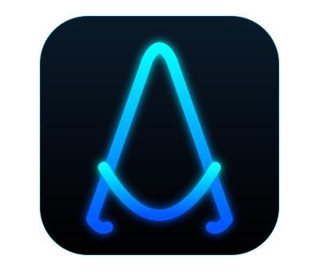
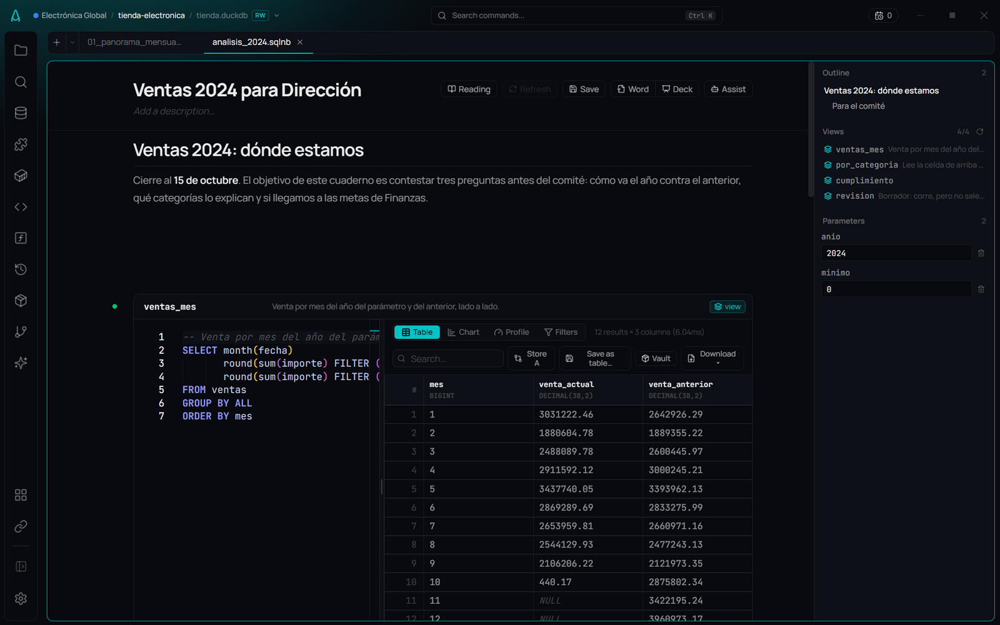
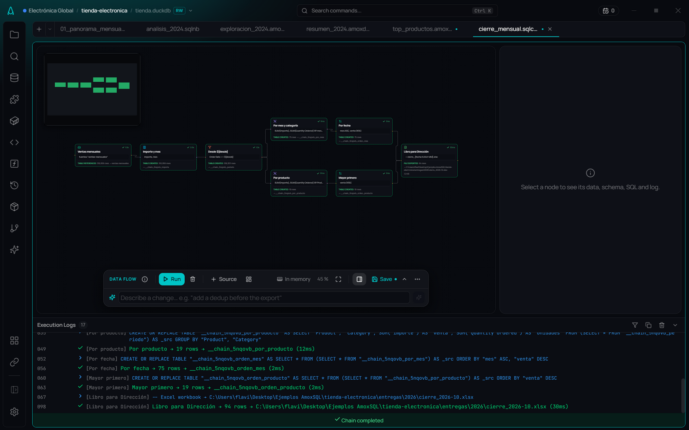
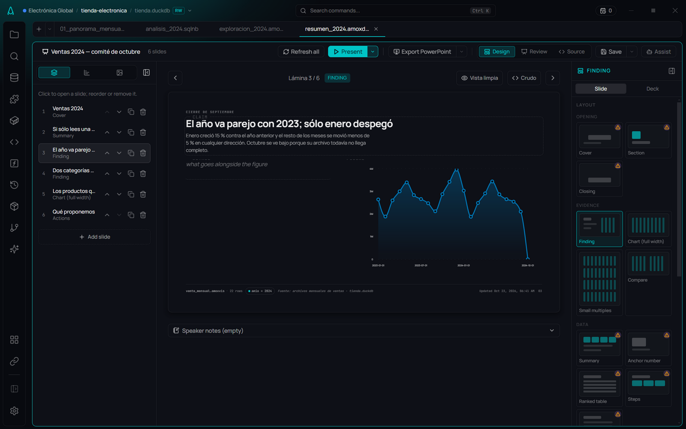
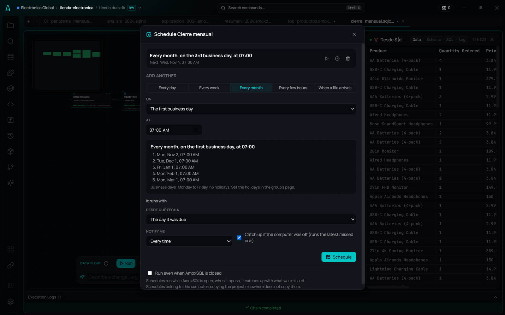
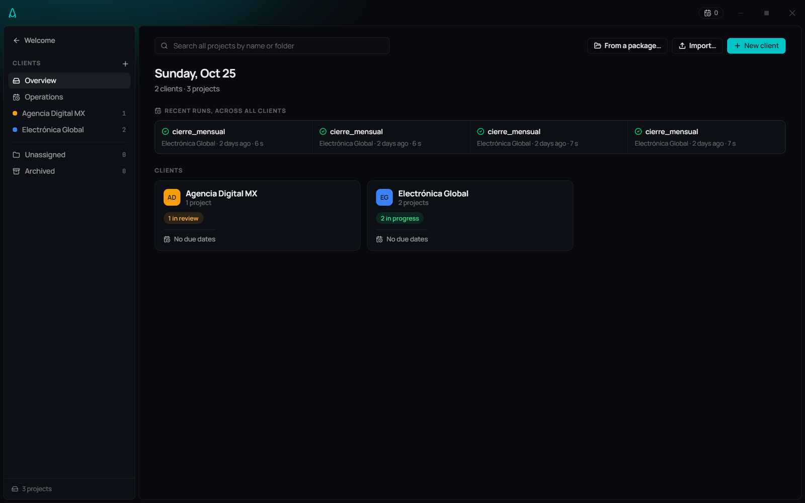

# AmoxSQL

> **The Modern Codex for Local Data Analysis.**
>
> *A high-performance, local-first data IDE — built from Latin America for the global community.*

**🌐 English · [Español](./README.md)**

[](https://duckdb.org/)
[](https://github.com/dsandovalflavio/amoxsql/releases/latest)
[](./LICENSE)
[](https://github.com/dsandovalflavio)

**AmoxSQL** is a desktop data IDE built for [DuckDB](https://duckdb.org/): a local workbench where files come in, get analyzed and explained, and go out as an Excel workbook, a deck or a process that runs on its own. For analysts and data engineers who need speed and privacy — your data, the engine and even the AI live on your machine.


---

## ✨ Capabilities

| | What it does | Guide |
|---|---|---|
| **SQL editor** | Monaco with autocomplete that knows your real schema (each alias's columns, CTEs, your metrics as functions), CTE debugging, variables, history and snippets. | [→](./docs/en/editor/sql-editor.md) |
| **Notebooks** | `.sqlnb` in plain markdown: each cell leaves a view named after it, the next one reads it, and **Refresh** runs them in dependency order. Parameters, drafts, export to Word and HTML. | [→](./docs/en/notebooks/notebooks.md) |
| **Canvas** | An infinite canvas to think an analysis through: sources, queries, charts, numbers and notes connected by what each query reads. Presents as slides and exports to a deck, notebook or process. | [→](./docs/en/notebooks/canvas.md) |
| **Story Flow** | Charts that tell something: 17 types in 6 stages (type, data, format, style, story, export), with takeaway, annotations and goal lines. | [→](./docs/en/visualization/story-flow.md) |
| **Report Flow** | `.amoxdeck` decks with charts that refresh against the data; export to editable PowerPoint and Word. | [→](./docs/en/reports/report-flow.md) |
| **Data where it lives** | **Named sources** over a file, a folder of monthly files, a bucket or a lake, with a **contract** that stops a run when the client changes a column. | [→](./docs/en/data/sources.md) |
| **Data Flow** | Visual processes (37 step types): from source to a formatted Excel workbook, the client's template or a published Parquet. Typed parameters, forms and batch runs. | [→](./docs/en/data-flow/data-flow.md) |
| **Runs on its own** | **Scheduling** (business days, the Nth business day, when a file arrives), notifications, a run record and the **Operations** panel. | [→](./docs/en/data-flow/scheduling.md) |
| **Workspaces** | Group projects by client, team or brand: shared context, metrics and snippets, an AI policy per client, and what needs attention. | [→](./docs/en/user-guide/workspaces.md) |
| **dbt and DuckLake** | dbt inside the editor (model bar, preview, completion, lineage with results) and DuckLake lakes with versions and "as it was". | [→](./docs/en/dbt/dbt-studio.md) |
| **Agentic AI** | Editor assistant and **Deep Dive**, with your context (metrics, joins, glossary). 100% local with Ollama or in the cloud. | [→](./docs/en/ai/introduction.md) |
| **Profile & plan** | Profiling with findings (duplicates, outliers, gaps) and the real execution plan with hints. | [→](./docs/en/results/data-profiler.md) |

---

## 🧭 A real case: the monthly sales close

The [**example project**](./docs/en/user-guide/example-project.md) walks through a complete case with real data: an online store sends a sales CSV every month and Finance its targets in Excel. In one project: a named source with a contract, a modeled database, eight queries, a notebook, charts, a Canvas, the committee deck, and a Data Flow close scheduled for the third business day that delivers a two-sheet workbook.

<table>
  <tr>
    <td></td>
    <td></td>
  </tr>
  <tr>
    <td align="center"><sub>Notebook: each cell is a view the next one reads</sub></td>
    <td align="center"><sub>Story Flow: the chart and what it means</sub></td>
  </tr>
  <tr>
    <td></td>
    <td></td>
  </tr>
  <tr>
    <td align="center"><sub>Data Flow: from the file folder to the management workbook</sub></td>
    <td align="center"><sub>Report Flow: the committee deck, refreshable</sub></td>
  </tr>
  <tr>
    <td></td>
    <td></td>
  </tr>
  <tr>
    <td align="center"><sub>Scheduling: the 3rd business day of every month</sub></td>
    <td align="center"><sub>Workspaces: every client, their projects and runs</sub></td>
  </tr>
</table>

---

## 📚 Documentation

The full guide (bilingual ES/EN) lives in **[`docs/`](./docs/README.md)**:

- **Get started:** [Introduction](./docs/en/user-guide/introduction.md) · [Installation](./docs/en/user-guide/installation.md) · [First steps](./docs/en/user-guide/first-steps.md) · [Example project](./docs/en/user-guide/example-project.md) · [The interface](./docs/en/user-guide/interface.md) · [Workspaces](./docs/en/user-guide/workspaces.md)
- **Editor & data:** [SQL editor](./docs/en/editor/sql-editor.md) · [Named sources](./docs/en/data/sources.md) · [Contracts](./docs/en/data/source-contracts.md) · [Import](./docs/en/data/importing-data.md) · [Export](./docs/en/data/exporting-data.md)
- **Analysis:** [Notebooks](./docs/en/notebooks/notebooks.md) · [Canvas](./docs/en/notebooks/canvas.md) · [Results table](./docs/en/results/results-table.md) · [Data Profiler](./docs/en/results/data-profiler.md) · [Execution plan](./docs/en/results/execution-plan.md)
- **Studios:** [Story Flow](./docs/en/visualization/story-flow.md) · [Report Flow](./docs/en/reports/report-flow.md) · [Data Flow](./docs/en/data-flow/data-flow.md) · [Scheduling](./docs/en/data-flow/scheduling.md) · [dbt](./docs/en/dbt/dbt-studio.md)
- **AI:** [Introduction](./docs/en/ai/introduction.md) · [Deep Dive](./docs/en/ai/deep-dive.md) · [Providers & models](./docs/en/ai/providers-and-models.md) · [Context as code](./docs/en/ai/context-as-code.md)
- **Reference:** [File formats](./docs/en/reference/file-formats.md) · [Configuration](./docs/en/reference/configuration.md) · [Shortcuts](./docs/en/reference/keyboard-shortcuts.md) · [Glossary](./docs/en/reference/glossary.md)

---

## ⬇️ Installation

**Download:** the installers are on **[GitHub Releases](https://github.com/dsandovalflavio/amoxsql/releases/latest)**.
- **Windows** — `AmoxSQL Setup <version>.exe` (NSIS, unsigned: Windows may ask you to confirm).
- **macOS (Apple Silicon · M1–M4)** — `AmoxSQL-<version>-arm64.dmg`. ⚠️ **Beta, not yet verified on real Mac hardware** — try it and [give us feedback](https://github.com/dsandovalflavio/amoxsql/issues). First launch: `xattr -cr /Applications/AmoxSQL.app` (see the [guide](./docs/en/user-guide/installation.md)).

**Build from source** (always free): requires Node.js 22.13+, pnpm 11+, and C++ build tools.
```bash
git clone https://github.com/dsandovalflavio/amoxsql.git && cd amoxsql
pnpm install && pnpm --dir client install
pnpm start
```
Full guide: [Installation](./docs/en/user-guide/installation.md).

---

## 🆕 What's new

The current version is **v5.15.0 — The Canvas**: an infinite canvas to think an analysis through, with cards connected by what each query reads, a snapshot that opens without running anything, and export to a deck, a notebook or a process. It also gathers everything since 5.10: data where it lives (named sources, folders, buckets, lakes), processes that run on their own (scheduling, Excel and templates, parameters, Operations), dbt and DuckLake inside the editor, reliable flows (source contracts, "Needs attention", metrics as functions) and the day-to-day (where you left off, projects in one file, comparing deliveries).

> Full history in **[CHANGELOG.md](./CHANGELOG.md)**.

---

## 📜 The name

**"Amox"** comes from the Nahuatl ***Amoxtli*** ("book" or "codex"). In Mesoamerica, codices recorded knowledge — history, calculations, learning. AmoxSQL is a modern digital codex for the data era: it turns raw, opaque data into clear, luminous visualizations. The luminous glyph fuses ancient structure with modern energy.

---

## 🛠️ Tech stack

Desktop (Electron) · Frontend [React](https://reactjs.org/) + [Vite](https://vitejs.dev/) + [Monaco](https://microsoft.github.io/monaco-editor/) + [Recharts](https://recharts.org/) · Backend [Node.js](https://nodejs.org/) + [Express](https://expressjs.com/) · Engine [DuckDB](https://duckdb.org/) · AI [Ollama](https://ollama.ai/) (local) + cloud (Google Gemini, Anthropic, OpenAI, Google Vertex) via [Vercel AI SDK](https://sdk.vercel.ai/).

More in [Architecture](./docs/en/concepts/architecture.md).

---

## ❤️ Sponsor

AmoxSQL is built and maintained by a solo developer from Latin America. If you find it useful, consider sponsoring. Sponsors get pre-built installers, early access, feature priority, and a direct channel.

👉 **[Become a Sponsor](https://github.com/sponsors/dsandovalflavio)**

---

## ⚖️ License

Source-available under the **AmoxSQL Community License**. You may view, modify, and build the code for personal or educational use. **Commercial redistribution and SaaS use are prohibited.** See [LICENSE](./LICENSE).

"AmoxSQL" and its logo are trademarks of Flavio Sandoval.

---

## 🤝 Contributing

Contributions welcome! See [CONTRIBUTING.md](./CONTRIBUTING.md). By contributing, you agree to license your work under the AmoxSQL Community License.

---

<p align="center">
  <a href="https://dsandovalflavio.github.io/amoxsql-landing-page/">🌐 Website</a> ·
  <a href="./docs/README.md">📚 Docs</a> ·
  <a href="https://github.com/sponsors/dsandovalflavio">💖 Sponsor</a>
  <br><br>
  Built with 💙 from Latin America for the World.
</p>
