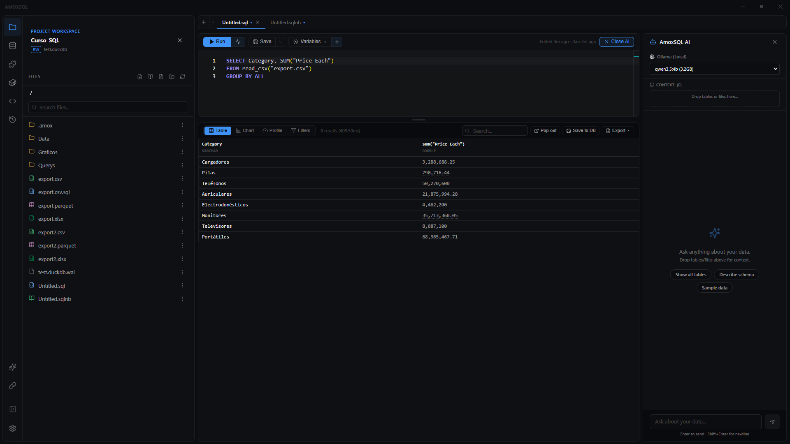

# Editor Assistant

**🌐 English · [Español](../../es/ai/editor-assistant.md)**

> Your copilot in the editor: a compact sidebar, tied to the open file, that generates, explains, and fixes SQL and proposes charts — all about the query in front of you.

## What it is

The Assistant is the AI mode with the least autonomy and the most proximity. It lives in a sidebar next to the [SQL editor](../editor/sql-editor.md) or the [notebook](../notebooks/notebooks.md), and it's always **tied to the active file**: it sees your current query, the last result, and the configured chart, so its answers are about what you're doing, not in the abstract.

It's reactive and conversational but compact: it opens with the finding, weaves the numbers into the sentence, and closes with the next step. You drive; it helps. When a question deserves a full analysis over the whole database, promote it to [Deep Dive](deep-dive.md) with a button.

## When to use it

- You're writing SQL and want to generate, explain, or optimize it.
- A query fails or returns something odd and you want to understand why.
- You have a result and want to chart it well in one shot.
- For a narrated, autonomous analysis over the **whole** database, use [Deep Dive](deep-dive.md) instead of the Assistant.

## How to use it

### Open the Assistant
1. Open a file. The **Assist** button is in the SQL editor, the notebook, Markdown, Report Flow and the Story Flow header; **Ctrl+L** opens it on any file.
2. Type your question and send with **Enter**.

The Assistant knows what file it has in front of it (a query, a notebook, a deck, a chart, a Data Flow…) and treats it as such.
See the table [What it can change in each file](#what-it-can-change-in-each-file).

### Generate, explain, or optimize SQL
1. With the query in the editor, ask *"explain this query"*, *"optimize it"*, or describe what you want to get.
2. The Assistant answers in prose and, when it proposes changing the file, shows the proposal.

"This" is what you have in front of you: the selected text if there is a selection; otherwise, the statement under the cursor. A file with several queries is no longer treated as one.

### Ask about part of the file
1. Select more than one word in the editor. A small bar appears below it: **Explain · Fix · Optimize · Ask…** in SQL, **Explain · Improve · Ask…** in a text file, and **Rewrite · Shorter · Explain · Continue · Ask…** in Markdown (the formatting bar stays above the selection).
2. **Explain**, **Fix**, **Optimize** and **Improve** send the question about that selection. **Ask…** (or **Ctrl+L** with text selected) opens the box for you to type your question.
3. While there is a selection, the chat box shows it: *Selection · lines 18–20*.
4. **Escape** closes the bar until the selection changes.

### In a notebook
The Assistant knows which cell you are in, and sees its result or its error, the other cells (with what each one reads), the views they already left in the session, and the parameters with their values.

- In each cell's gutter, the **Assist** control opens a menu. In a SQL cell: **Explain this cell**, **Fix the error** (if it failed) and **Chart the result** (if it has one). In a text cell: **Write from the result above** (if the cell above has a result) and **Improve this text**.
- When a cell fails, **Fix with Assist** appears next to its error.
- An empty text cell below a result offers **Write from the result above**.

It proposes **cell by cell**, never the whole notebook: a cell's change shows below it, with what goes out and what comes in; a new cell shows as a **ghost** (dashed border) where it would go. Both can be accepted or rejected right there or from the chat. Accepting doesn't touch the other cells or their results.

### In Report Flow
The Assistant knows which slide you are on, and sees the deck slide by slide (its layout, text and notes) and, for each chart, its type, its axes and the query it comes from.

- In the slide's bar, **Assist** opens a menu: **Tighten the text**, **Write the headline from the chart** (if the slide has a chart), **Speaker notes** and **Add a slide after**.

It proposes **slide by slide**, never the whole deck: one slide's layout, text, charts and notes, or a new slide. A slide with a proposal carries the Assistant's mark in the outline; a new slide shows as a **ghost** (dashed border) where it would go. Above the slide, a bar with **Before** / **Proposal** lets you see it as it is and as it would be, plus **Accept** / **Reject**. Accepting doesn't touch the other slides or the front matter, and **Ctrl+Z** undoes it.

### In a chart
The Assistant knows which Story Flow stage you are in (Type, Data, Format, Style, Story, Export, or the Code view), and sees the chart type, the panels you set, the query, its columns and a few sample rows.

- In the Story Flow header, **Assist** offers your stage's question first: *Which chart tells this best?* in Type, *Write the takeaway* in Story, *Make it readable in a slide* in Style…
- **Auto Story**, in the Story stage, no longer writes over your texts: it proposes the title, subtitle, footnote and takeaway, and you accept or reject them.

It proposes **panel changes** (the type, the axes, the highlight, the texts…), the same ones you would make, never the file's JSON. A panel that the chart type doesn't draw is never proposed. Above the figure, **Before** / **Proposal** shows the chart as it is and as it would be, with the list of what changes (*Type: area → line · Highlight: max*). In the **Code** view it can propose a whole Vega-Lite spec.

### Fix an error
When a query fails, **Fix with Assist** appears next to the error message. The Assistant already knows the error and the query: no need to paste anything. When you start a conversation with the query in error, the first suggestion is **Fix the error**.

### Ask about a result
In the results bar of a `.sql`, **Explain** asks what stands out and **Chart it** asks for a chart of that result.

### Accept or reject an edit
In a `.sql` or a text file, the Assistant proposes **only the lines that change**, and the change is shown **in the editor itself**: what goes out, in red on its line; what comes in, in green below it; above, a bar with **Accept** / **Reject**. While it is pending, those lines can't be edited. If you type elsewhere in the file, the proposal follows its lines. **Review**, in the chat, takes you to it.

Markdown works the same way, in the **Write** or **Split** view. In the **Read** view, a notice says there is a proposal and **Show it** opens it in the split view.

In every file:

1. **Accept** puts the change in the editor **without saving to disk** — you review and save (Ctrl+S). **Reject** discards it. In the chat, each proposal also has **Accept** / **Reject** and **Review**, which takes you to it.
2. What you decided is remembered: when you reopen the conversation, the block says **Applied to the editor** or **Rejected**.
3. If that part of the file changed since the proposal was made (its lines, its cell, its slide, those panels), accepting it would erase what you did afterwards. So it isn't applied: the block says so and offers **Propose again**, which asks for it again on the current version.

### Create a new file
If you ask for something that belongs in another file (*"save this query to a file"*), the Assistant proposes the path and the content. Nothing is written until you click **Create**, which creates the file and opens it. It never overwrites an existing file.

### Insert a query from the chat
Under each SQL block in the chat, **Insert at cursor** puts the query where the editor's cursor is, or over the selected text if there is a selection. The rest of the file is untouched and **Ctrl+Z** undoes it. You also have **Copy** and **Run**.

### Apply a chart
1. On a result of a `.sql`, ask *"chart this by region"* or similar.
2. The Assistant proposes a fully configured chart; click **Apply to chart** to send it to the chart of that query's results, in [Story Flow](../visualization/story-flow.md). Only that chart changes, not the ones in other tabs.

### Add context (drag & drop)
Drag a table from the [database explorer](../data/database-explorer.md) or a file from the [file explorer](../data/file-explorer.md) and drop it on the chat. It stays as conversation context and is sent with every question.

### Choose model and skill
In the chat's bottom bar you pick the **model** (see [Providers & models](providers-and-models.md)) and, if your project ships [Skills](skills.md), the **active skill** that frames the reasoning.

## Reference

### What the Assistant can do

| Capability | What it does |
|---|---|
| Answer questions | About your query, your data, or DuckDB SQL in general |
| Generate / explain / optimize SQL | Writes or rewrites the active file's query |
| Propose edits | Change with **Accept** / **Reject**; accepting loads it in the editor unsaved. Only the part that changes (lines, a cell, a slide, some panels), reviewed where it lives |
| Ask from the editor | The bar over a selection, **Fix with Assist** on an error, **Explain** / **Chart it** on results |
| Propose new files | Path and content with **Create**; never overwrites |
| Propose charts | Configured chart with **Apply to chart** into Story Flow |
| Cite numbers | Values link back to their source query ("Source Query") |
| Drag-drop context | Tables and files dropped on the chat |

### Context it sees automatically

| Item | Where from |
|---|---|
| Current query | The active editor buffer, with numbered lines |
| Where you are | The selected text, or the statement under the cursor; in Markdown, the section; in a notebook, the cell; in a deck, the slide; in a chart, the Story Flow stage |
| The last error | The message of the last run that failed |
| A dbt model | Its YAML columns and descriptions, and the SQL dbt compiled (without running dbt); changes are proposed in Jinja |
| Last result | The results table on screen |
| Chart config | The active Story Flow chart |
| Schema | All tables in the local database |
| Project rules | `RULES.md` and `context/` (see [Context as code](context-as-code.md)) |

### What it can change in each file

| File | What the Assistant does |
|---|---|
| `.sql`, `.md` Markdown, text (`.yml`, `.json`…) | Proposes the lines that change, reviewed in the editor |
| `.sqlnb` notebook | Proposes cell by cell: the change below its cell, or a new cell in its place |
| `.amoxdeck` Report Flow | Proposes slide by slide: Before / Proposal on the slide, or a new slide where it would go |
| `.amoxvis` chart | Proposes panel changes (or, in the Code view, a Vega-Lite spec): Before / Proposal on the figure |
| `.sqlchain` Data Flow, `.amoxcanvas` Canvas, `.amoxdiagram` diagram | Explains what to change and where, so you do it in its editor. It doesn't propose changes yet: rewriting the file by hand would break it |
| A very long file | Sees the first part and says so; it doesn't propose rewriting it, since it would lose what it can't see |

### What doesn't leave your computer

- **A Canvas's snapshots** (each card's saved rows) are never sent to the model: it sees the SQL and the shape of the canvas.
- **Credential files** (`profiles.yml`, `.env`, keys) are never sent to a cloud model. With a local model, they are.
- **The workspace's [AI policy](../user-guide/workspaces.md)** applies to the open file too: with "schema only", a data file opened as text or rows written inside a chart don't leave; with "samples", only their first lines do.

## Tips & gems

- **Accept doesn't save:** an accepted edit enters the editor but doesn't touch disk until you press **Ctrl+S** — always review first.
- **Promote it:** did the question grow? The promote button sends it to [Deep Dive](deep-dive.md) while keeping the context.
- **Conversations are remembered per file:** reopen a `.sql` and you get back the Assistant chat tied to that file.
- **Click a cited number:** it jumps to the exact query that produced it.

## Related

- [Deep Dive](deep-dive.md) · [Providers & models](providers-and-models.md) · [Agent tools](agent-tools.md)
- [SQL editor](../editor/sql-editor.md) · [Story Flow](../visualization/story-flow.md)
- [Skills](skills.md) · [Context as code](context-as-code.md)
