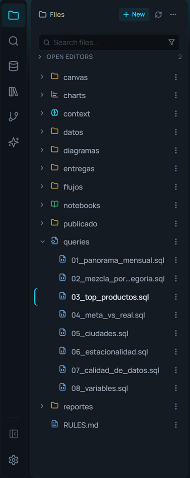

# File explorer

**🌐 English · [Español](../../es/data/file-explorer.md)**

> Your project's files: open them, find them in any folder, create, rename and move, and import data into the database, all from the sidebar, without leaving AmoxSQL.

## What it is

The file explorer is the **Files** panel on the left. It shows your `.sql` scripts, `.sqlnb` notebooks, `.amoxvis` charts, `.amoxdeck` decks, `.sqlchain` processes, data (CSV, Parquet, JSON, Excel), and any other file, each with a color-coded icon by type.

It's your entry point to data: from here you open files, import them into the database, query them directly, or copy their column names. It also manages the file lifecycle (create, rename, move, duplicate, delete) without touching your operating system's explorer.

Some files are hidden on purpose: databases (`.duckdb`, `.db`, lakes), which you connect from the **Data** panel; what AmoxSQL writes for itself next to your files (a notebook's visual state, the temporary files of a write); and files and folders whose name starts with a dot, unless you turn on **Show hidden files**.

## When to use it

- To open any project file, or create a new one.
- To find a file without knowing which folder it's in.
- To bring a CSV/Parquet/JSON/Excel into the database as a table (see [Importing data](importing-data.md)) or query it in place without importing.
- To reorganize the project: move, rename, duplicate, or bulk-delete files.
- For the schema already loaded in the database, use the [Database explorer](database-explorer.md); this panel is for files on disk.

## How to use it

### Two ways to see the project
In **Settings → Behavior → File Explorer → Explorer View** you choose:

- **Folders** (the default): one folder at a time. Click a folder to enter it; the **breadcrumb** at the top (or the **Up** arrow) takes you back.
- **Tree**: the whole project as a tree. Each folder unfolds in place with its arrow, and the project remembers which ones you left open. The **…** menu adds **Collapse all**. The active tab's file is **revealed** on its own: the folders that contain it open and its row is marked with a bar in the accent color.

### Find a file
Type in **Search files…**: it looks through the **whole project**, not only the folder on screen, and each result shows the folder it lives in. If the text has a slash, it is compared with the whole path: `2024/cie` finds `reports/2024/cierre.sql` and not `reports/2023/cierre.sql`.

The **funnel** in the search box filters by type (**Show only**): SQL, Notebooks, Charts, Data Flow, decks/canvases/diagrams, data files, and Markdown/text. You can tick several; the funnel shows how many are on, and the filter is remembered. With a type ticked and no text, you see every file of that type in the project. **Show all types** clears it.

### On top: Open Editors and Favorites
- **Open Editors** lists the open tabs (each pane's separately when the screen is split), with the active one marked and a dot on those with unsaved changes. A click activates it; the **X** (on hover) or a middle click closes it. It starts folded; unfold it with its title.
- **Favorites**: right-click a file or folder → **Add to Favorites**. Each project has its own, and they follow the file when you rename it from the explorer. A favourite folder unfolds in the tree (or is entered in the folder view). The star on the row removes it. The section only appears when there is one.

### Charts go with their query
A chart saved from a `.sql` (**Save as chart…**) shows **under its query** when both are in the same folder: the `.sql` gets an arrow that unfolds its charts. If the chart is in another folder, or doesn't come from a `.sql`, it shows on its own like any file. Turn it off in **Settings → Behavior → File Explorer → Nest Related Files**.

### Open a file
Click the file. What happens depends on the type:
- `.sql`, `.sqlnb`, `.md`, `.amoxdeck`, `.sqlchain`, `.amoxcanvas`, `.amoxdiagram` → open in their editor.
- `.amoxvis` → opens the chart in Story Flow.
- `.xlsx`/`.xls` → **always** open as a Direct Query.
- `.csv`, `.parquet`, `.json` → follow your default-data-file-action setting (preview or direct query).

**Drag** a file from the explorer onto the editor to open it in the pane where you drop it; a data file is queried, as when you drop it from your system. **Open to the Side** (in the context menu) opens it in the other pane, splitting the screen if needed.

### Create files and folders
**+ New** in the header opens a menu with every file type and **New folder**; they're created in the current folder. On a folder, the context menu adds **New File Here** and **New Folder Here**.

### Sort
The **…** menu in the header sorts the list: default (folders first), by name, **by date modified** (newest first), by category, by extension, and by size. In category or extension mode, the folder view groups files under headers with a count. The default order is chosen in **Settings → Behavior → Default Explorer Sort View**. **Show hidden files** is in the same menu.

The file name comes first: a long name is cut **in the middle**, because its end is usually what tells it apart. Size and date show on hover or when selected.

### File operations
Right-click (or the three-dots button) opens the context menu:
- **Open to the Side**, **Open as text**.
- **Cut / Copy / Paste** (also `Ctrl+X` / `Ctrl+C` / `Ctrl+V`).
- **Duplicate**, **Move To…** (folder picker), **Rename** (`F2`).
- **Add to .gitignore**, **Delete** (bulk-deletes if several are selected).
- **Add to Favorites**, **Reveal in Explorer** (opens the folder in your OS), **Copy Path** (the full path on disk), **Copy Relative Path**, **Copy Name**.

You can **drag** a file onto a folder to move it. Select several with `Ctrl+click` or `Shift+click` to act in bulk.

### Actions on data files
For CSV/TSV/Parquet/JSON/Excel, the menu adds data actions:
- **Import to Database…**: creates a table (see [Importing data](importing-data.md)).
- **Quick Preview**: 100 rows in a modal (CSV/Parquet/JSON).
- **Direct Query**: opens a SQL tab with the `SELECT * FROM '<path>'` (or `read_xlsx(...)` for Excel) plus column comments; for CSV/Parquet/JSON it runs immediately.
- **Copy Column Names**: to the clipboard as a SQL comment (per sheet for Excel).
- **Metadata for AI…**: generates file context (see [Metadata for AI](../ai/metadata-for-ai.md)).

On a `.sql`, the menu offers **Export results…**, which reads the file's query and opens the export dialog (see [Saving results](../results/saving-results.md)), and **Charts using this query…**.

## Reference

### Header, search and context menu
| Action | What it does |
|---|---|
| + New | Creates a file of the chosen type, or a folder, in the current folder |
| … | Sort · Show hidden files · Collapse all (in the tree) |
| Search files… | Searches by name (or by path, with a slash) across the project |
| Funnel (Show only) | Only the ticked types, across the project |
| Open to the Side | Opens the file in the other pane |
| Cut / Copy / Paste | Move or copy files (`Ctrl+X/C/V`) |
| Duplicate · Move To… · Rename | Copy with suffix · pick destination folder · `F2` |
| Add to .gitignore | Adds the file/folder pattern to `.gitignore` |
| Add to / Remove from Favorites | Puts it on top, in Favorites |
| Reveal in Explorer | Opens the location in your operating system |
| Copy Path · Copy Relative Path · Copy Name | The full path · the path inside the project (with `/`) · just the name |
| Delete | Deletes the file or the whole selection (with confirmation) |

### Settings (Behavior → File Explorer)
| Setting | Default | What it does |
|---|---|---|
| Nest Related Files | On | A `.sql`'s charts, under it |
| Explorer View | Folders | Folders (one at a time) or Tree (the whole project) |
| Show File Sizes in Explorer | On | The size next to the name on hover |
| Default Explorer Sort View | Default | The order it opens with |

### Git status badges
| Badge | Meaning |
|---|---|
| M | Modified |
| A | Added |
| D | Deleted |
| ? | Untracked |
| Dot on a folder | There are changes inside |

## Tips & gems

- **Find by folder:** type `reports/` and you'll see everything under any `reports` folder.
- **Excel is always a Direct Query:** opening an `.xlsx` doesn't import it; it scaffolds a `read_xlsx(...)` query so you decide.
- **Favorites for the daily ones:** the month-end `.sql`, the deliveries folder; one click away, without going down the tree.
- **Copy Column Names is sheet-aware:** on an Excel file it copies each sheet's columns labeled by name.
- **The Google Sheets section** lives at the bottom of the panel; connect sheets by URL (see [Google Sheets](google-sheets.md)).

## Shortcuts and related formats

| Shortcut | Action |
|---|---|
| Ctrl+Shift+E | Show the file explorer |
| F2 | Rename the selected file |
| Delete | Delete the selection |
| Ctrl+C · Ctrl+X · Ctrl+V | Copy · Cut · Paste |
| Ctrl+click · Shift+click | Multi-select (individual · range) |

## Related

- [Layout, tabs and panes](../editor/layout-tabs-and-panes.md) · [Database explorer](database-explorer.md) · [Importing data](importing-data.md)
- [Google Sheets](google-sheets.md) · [Saving results](../results/saving-results.md) · [Metadata for AI](../ai/metadata-for-ai.md)
- [File formats](../reference/file-formats.md) · [Configuration](../reference/configuration.md)
