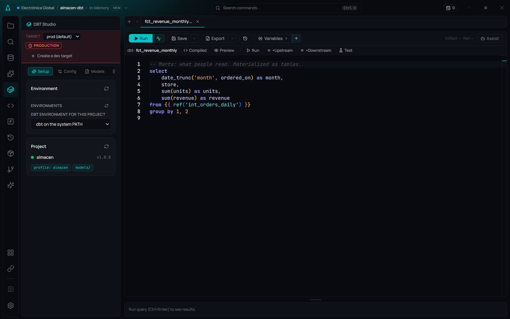

# DBT Studio

**🌐 English · [Español](../../es/dbt/dbt-studio.md)**

> AmoxSQL's panel for dbt projects on DuckDB: it sets up the dbt environment, picks the target, creates the project with examples, runs commands with a summary, schedules them, and shows the lineage with what happened to each model.

## What it is

**DBT Studio** is AmoxSQL's panel for working with a dbt project that runs on DuckDB. It has six sections: **Setup**, **Config**, **Models**, **Sources**, **Lineage** and **Commands**. The project's files (`dbt_project.yml`, `profiles.yml`, the `.sql` models and their YAML) live in your folder as usual.

Since 5.12, dbt is no longer a separate panel. A model open in the editor has its own bar to compile, preview and run it ([Models in the editor](models-in-the-editor.md)). The lineage says what happened to each node ([Lineage](lineage.md)). AmoxSQL's sources are used in dbt without copying paths ([AmoxSQL sources in dbt](amoxsql-sources-in-dbt.md)).

## When to use it

- When you transform data in DuckDB **with dbt** and want to do it without leaving AmoxSQL.
- To **start a dbt project** that works the first time: the environment, a project with one example per layer, and its database.
- To **run and schedule** `dbt build` and see in one line how it went.

If you only want to query DuckDB, use the [SQL Editor](../editor/sql-editor.md).

## How to use it

### 1. The dbt environment (Setup)

dbt is a Python program. Under **Environment** you choose which one runs this project:

- **AmoxSQL's own.** **Set up dbt…** creates it for you: it looks for Python 3.10 to 3.13 on the computer, creates an environment inside AmoxSQL's folder and installs dbt with **the same engine version AmoxSQL uses** (DuckDB 1.5.6). It takes a minute or two and shows its progress. This is the recommended option: dbt and AmoxSQL read and write the same database with no format surprises.
- **A Python environment you already have** (a folder with dbt installed), **a Conda environment**, or **dbt on the system PATH**.

The choice is saved in the project (`.amoxsql/project.json`), so it travels with it. If that environment's DuckDB package is not AmoxSQL's engine version, the **Output** panel says so before running.

### 2. The project

If the folder has no dbt project, type a name and click **Initialize Project**. AmoxSQL creates a project that **runs the first time**:

- an example seed (`seeds/example_orders.csv`);
- one model per layer, chained with `ref()`: `stg_orders` → `int_orders_daily` → `fct_revenue_monthly`;
- tests in the YAML, `persist_docs` (descriptions reach the database and the explorer) and `store_failures` (the rows that break a test can be seen);
- a single target, `prod`, marked as production.

The project is detected as soon as the panel opens.

### 3. The target (the bar under the header)

The **Target** bar says which database commands write to. A production target shows in red with **PRODUCTION**.

- With a single target, commands write to production without asking: it's your project and there's nowhere else.
- **Create a dev target** adds `dev`, a copy of the active one with its own database (`tienda.duckdb` → `tienda_dev.duckdb`), to try changes before touching production. Only if you create it.
- If the project doesn't say which target is production, the bar asks (**Which target is production?**) and suggests `prod`.
- **With another target next to it**, a command that writes to production (`run`, `build`, `seed`, `snapshot`, `--full-refresh`) asks you to **type its name** before it runs.

The active target is saved in the project and added to each command as `--target`, unless the command names another.

### 4. Commands

1. Use the **quick actions** (Run All, Compile, Test, Debug, Docs) or the **builder**: the action (`run`, `build`, `compile`, `test`, `seed`, `snapshot`, `source freshness`, `docs generate`, `debug`, `deps`, `clean`, `parse`), `--select`, `--exclude` and `--full-refresh`.
2. Click **Execute**. The output streams into **Output**; AmoxSQL's own notes show in another color.
3. When it ends, **one line says how it went**: "dbt build · 3 models, 3 tests (1 warning), 1 seed · 9 s", or which model or test failed and why. **Details** opens the run's record, with each model and test as a step.
4. **Stop** ends dbt and everything it started. The database is left free.

dbt runs **with no shell in between and no time limit**: the command is parsed into arguments, and `&&`, `|`, `;`, redirections and `$(` are not accepted. Every run is kept in AmoxSQL's history like any process.

**A test in *warn*:** dbt ends "fine" (exit code 0) even when a test warns. AmoxSQL tells them apart: the summary says "Finished with 1 warning" and an "only on failure" notification fires too.

**No locks.** dbt writes to the `.duckdb` database from its own process. If it is going to open a database AmoxSQL has attached (the main one, or one a preview attached), AmoxSQL releases it and attaches it again when dbt ends, also if it fails or you stop it. Your notebook views, sources and extensions are still there. Meanwhile, a query on that database says why it is waiting.

### 5. Scheduling a command

The calendar button next to **Execute** opens **Schedule…** with the command: every night, every hour, the first business day or when a file arrives, just like a Data Flow process. The project's dbt schedules are listed underneath. See [Scheduling processes](../data-flow/scheduling.md#scheduling-dbt).

### 6. Templates (Models and Sources)

- **Models**: staging, intermediate, mart, incremental, *snapshot* (YAML, by timestamp or by comparing columns) or basic templates. The dialog explains in two lines what an incremental model and a snapshot are.
- **Sources**: create the YAML of a dbt source, and **AmoxSQL sources in dbt** to use AmoxSQL's [named sources](../data/sources.md) from dbt ([see](amoxsql-sources-in-dbt.md)).

## Section reference

| Section | What it does |
|---|---|
| **Setup** | The project's dbt environment (**Set up dbt…**), detect or create the project |
| **Config** | Edits `profiles.yml` and summarizes `dbt_project.yml` |
| **Models** | Model and snapshot templates |
| **Sources** | dbt source YAML and AmoxSQL sources in dbt |
| **Lineage** | The graph with each node's last result ([Lineage](lineage.md)) |
| **Commands** | Quick actions, builder, live output, summary, Stop and schedule |

## Tips and gems

- **From the command line:** `AmoxSQL.exe dbt build --select +fct_sales --project C:\my-project` runs dbt with the project's environment and target, with no window. See [Command line](../data-flow/command-line.md#dbt).
- **The dbt database in the explorer:** the views dbt creates can be read when you open its database in AmoxSQL; AmoxSQL attaches it under the name dbt uses (the file's name) when its views need it.
- **Descriptions:** with `persist_docs`, each model's and column's description shows in the [database explorer](../data/database-explorer.md#descriptions) and the assistant reads it.

## Related shortcuts and formats

| Format / file | Detail |
|---|---|
| `profiles.yml` | The targets: each one with its DuckDB database |
| `.amoxsql/project.json → dbt` | The environment, the active target and which one is production |
| `target/run_results.json`, `manifest.json` | What AmoxSQL reads for the summary and the lineage |
| `target/amox_ultimos.json` | Each node's last state, accumulated across commands |

## Related

- [Models in the editor](models-in-the-editor.md) · [Lineage](lineage.md) · [AmoxSQL sources in dbt](amoxsql-sources-in-dbt.md)
- [Lakes (DuckLake)](../data/lakes.md) · [Scheduling processes](../data-flow/scheduling.md) · [Command line](../data-flow/command-line.md)
