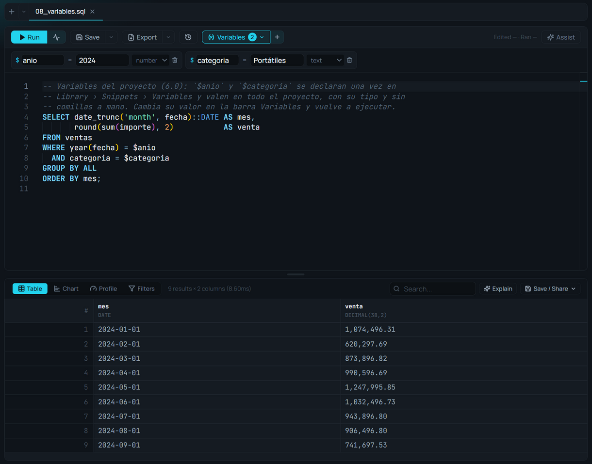

# Variables

**🌐 English · [Español](../../es/editor/variables.md)**

> Declare a value once — the region, the year, the threshold — and use it in any query of the project as `$name`, with its type and no quotes by hand. Since 6.0.

## What it is

A **project variable** has a name, a type, a value and, if you like, a description of what it is for. You write `$name` inside the SQL and the engine reads it **with its type**: a number is a number, a date is a date. That is why it needs no quotes and no value can change the query (a text like `'; DROP TABLE sales; --` is just a text).

Variables belong to the **project**, not to a tab: they are saved in `.amoxsql/variables.json`, travel with the folder (Git, an `.amoxproject`) and work in everything that runs inside it: the editor, notebook cells, Canvas cards, saved charts and Data Flow processes, scheduled runs included.

## When to use it

- When the same value shows up in several queries: the closing year, the report's region, an alert's threshold.
- To save a chart, a cell or a process that **keeps working**: they carry `$region`, not the value.
- So someone else on the project can change the value without touching the SQL.

## How to use it

### Declare them
In **Library › Snippets › Variables**, **New variable**:

1. **Name**: letters, digits and `_`, not starting with a digit.
2. **Type**: *Text*, *Number*, *Date*, *Yes / no* or *List*.
3. **Value**. A list is written comma-separated: `north, south, east`.
4. **Description** (optional): what it is. The editor shows it on hover, and the Assistant reads it.

A click on a variable in the list inserts `$name` into the editor. The pencil edits it and the bin removes it.

### Use them in SQL

```sql
SELECT region, sum(amount) AS sales
FROM sales
WHERE year(date) = $year
  AND region = $region
  AND amount > $threshold
GROUP BY region;
```

A list and a yes/no:

```sql
SELECT *
FROM sales
WHERE list_contains($regions, region)
  AND $active_only;
```

Typing `$` makes the editor offer the variables with their type and description, and hovering `$region` shows its value.

### The editor's Variables bar
The **Variables** button in the action bar (with the number of variables) unfolds the same list under the bar, to change a value without leaving the query: change `$year` and run again. The **+** next to it adds one. List and yes/no variables are edited in Library.



### If a variable doesn't exist
The error says it in words: "$region is not a project variable. Declare it in Library › Snippets › Variables". If someone hands you a query with `$something`, declare it and run again.

## `$name`, `${name}` and `{{name}}`

| Written as | What it does | What for |
|---|---|---|
| `$name` | The engine reads the project variable **with its type** | Values: dates, numbers, texts, lists |
| `${name}` | Pastes the variable's **text** into the SQL before running it | Templates: a table name, a piece of SQL |
| `{{name}}` | A **notebook** or **deck** parameter, belonging to that file | Texts and values of a report (see [Notebooks](../notebooks/notebooks.md)) |

For a value, use `$name`. `${name}` still works as before, but pastes the text as it is: a text needs its quotes (`'${region}'`) and nothing protects it.

## Tips & gems

- **What you saved keeps working:** an `.amoxvis`, a cell or a process with `$year` is recomputed with the project's current value.
- **`LIMIT $n` works**, like anywhere else in the query.
- **The Assistant knows them:** their names, types, values and descriptions, and uses them when it writes SQL.
- **In Data Flow**, a process's typed parameters are also read as `$x` (see [Command line and parameters](../data-flow/command-line.md)).

## Related

- [SQL editor](sql-editor.md) · [Snippets](snippets.md) · [Autocomplete](autocomplete.md)
- [Notebooks](../notebooks/notebooks.md) · [What's new in 6.0](../user-guide/whats-new-6.md)
