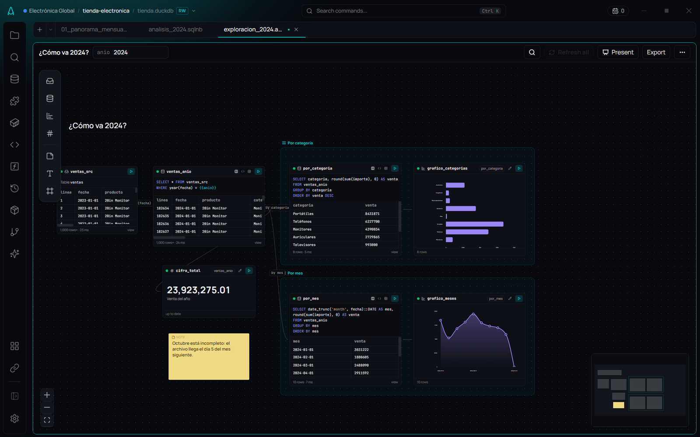

# Canvas (.amoxcanvas)

**🌐 English · [Español](../../es/notebooks/canvas.md)**

> An infinite canvas to think an analysis through: sources, queries, charts, numbers and notes in cards, connected by what each query reads. When the analysis takes shape, it goes out to a deck, a notebook or a process that runs on its own.

## What it is

A **Canvas** (`.amoxcanvas`) is the place to **find out**, before delivering. Where the [notebook](notebooks.md) reads top to bottom, the Canvas lets you keep two branches at once ("by store" and "by day" from the same clean base), a note next to the number that prompted it, and the whole path in sight.

Every data card leaves a **view with its name** in the session, like a notebook cell, and the card next to it reads it by that name. **Arrows are not drawn: they come from what each query reads**, so they never say something different from what the SQL does. Each arrow's label is deduced too ("by tienda", "where estado = 'ok'", "+ metas").

## When to use it

- Exploring a client's new file and trying paths before deciding which one holds.
- Comparing branches from the same clean base.
- Preparing a meeting: frames are presented as slides.
- Going from "I figured it out" to "let it run on its own": a branch goes out to Data Flow.

## How to use it

### Create one
**Canvas** on the editor's empty screen, in the tabs' "+" menu, in the file explorer's button or in the palette (*New Canvas*).

### The cards

| Card | What it is | Leaves a view |
|---|---|---|
| **Source** | A named source, a database table (also of another project you are looking at) or a data file | Yes |
| **Query** | SQL; you see the code, the result, or both | Yes |
| **Chart** | A Story Flow chart on another card's rows | No |
| **Number** | One figure (sum, average, count, minimum, maximum or the first row) and, optionally, its change against another card | No |
| **Note** | A sticky note | — |
| **Text** | A title or a paragraph in markdown | — |
| **Frame** | A frame that groups; it moves with what is inside and is one slide when presenting | — |

The toolbar on the left creates them. A **Source** is also created by **dropping** onto the canvas a source or a table from the database explorer, or a data file from the file explorer. A table or a file gives a `<name>_src` card (a view named like the table would read itself). Canvas cards **only read**: what changes data goes in a notebook or a `.sql`.

### Connect
- **Drag from the right edge** of a Source or a Query **to a gap**: **Filter… · Group by… · Join with… · Empty query · Chart · Number** appear, and the new card is born reading the original one, with its SQL written and editable.
- **Drop the connection on a Chart or a Number**: they show that card.
- For a query to read another card, write its name in the `FROM` or a `JOIN`: the arrow appears by itself.
- **Double-click an arrow** to write its label by hand; empty, the deduced one comes back.

### Edit
- **Double-click the SQL** to open the editor (with the usual completion) in that card only; **Ctrl+Enter** runs it.
- **Double-click the name** to rename: AmoxSQL shows which cards read it and rewrites their SQL (never a text, a comment or a column with the same name).
- A **Chart**'s pencil opens the full Story Flow editor over the canvas; a **Number**'s, its settings inside the card.
- **Delete** removes the selection. **Ctrl+F** finds a card by its name, SQL or text.

### Run, Refresh and the snapshot
- Every card has its **status dot**, like notebook cells: up to date, stale (you edited it or something it reads changed), not run in this session, or failed.
- **Refresh all** runs what is not up to date **in dependency order**, and charts and numbers after what they show. It stops at the first failure and says where. **Refresh from …** (in the "…" menu) does the same for one branch.
- When it goes well, each card keeps its **snapshot** in the file: the first 50 rows, the chart's points (up to 2,000) or the figure. Opening the canvas again shows that snapshot, marked **"Snapshot as of …"**, without running anything. **Clear snapshots** removes it if you don't want data in the file (for instance, before a commit).

### Parameters
A `{{name}}` in a card's SQL shows in the top bar with its value. Changing it makes stale only what uses it.

### Present
**Present** goes through the **frames** in reading order, one per screen: arrows or space to move on, **Esc** to leave. The canvas stays still and the bars go away.

### Take it out of the canvas
From **Export**:

| Option | What it does |
|---|---|
| **To Report Flow** | A deck with one slide per frame: its title, its texts and notes, a Number's figure and its charts (written as `.amoxvis` in `charts/`). Parameters become the deck's variables |
| **To a notebook** | A `.sqlnb` with the queries in dependency order, each with its name, and the notes as text |
| **Branch to Data Flow** | A process with the steps that lead to the selected card; each step leaves a table named after the card. Add an Excel or Export File step and schedule it |
| **Card as SQL** | The selected card's query in a `.sql` |

What goes out is **self-contained**: it carries, as `WITH`, the cards it depends on, because outside the canvas their views do not exist.

### What changed
**What changed** ("…" menu) and the Git panel show the changes of a `.amoxcanvas` as cards —added, removed, the SQL that changed—, not as JSON. Moving cards, the snapshot and the view mode do not count.

## The file

An `.amoxcanvas` is JSON with a fixed order and the SQL split into lines, so a one-line change is a one-line diff. See [File formats](../reference/file-formats.md).

## Tips

- Put a **frame** around each idea: when presenting and exporting, each frame is one slide.
- Use a **note** next to the figure that prompted it: it goes into the deck.
- If a branch already answers the question, **Branch to Data Flow** and schedule it.

## Related

- [Notebooks](notebooks.md) · [Story Flow](../visualization/story-flow.md) · [Report Flow](../reports/report-flow.md)
- [Data Flow](../data-flow/data-flow.md) · [Scheduling](../data-flow/scheduling.md) · [Named sources](../data/sources.md)
