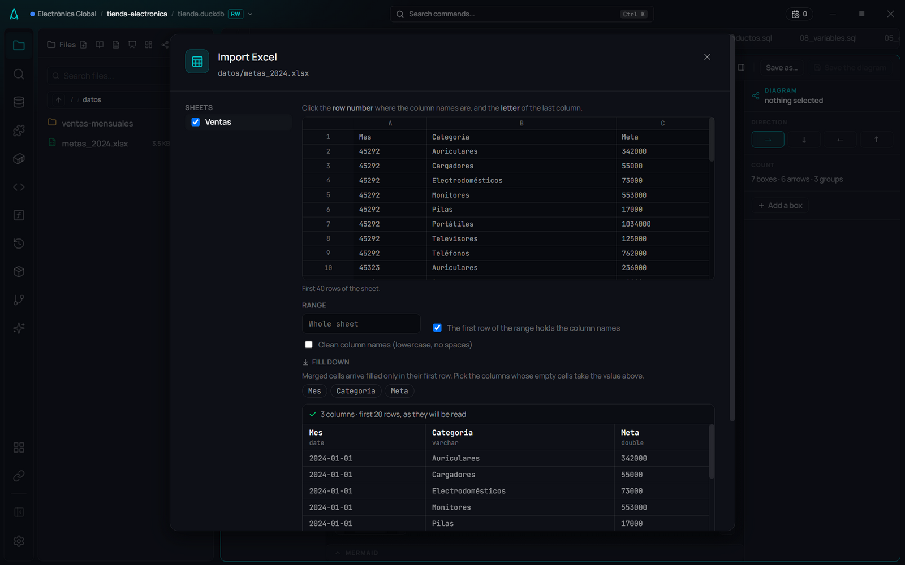
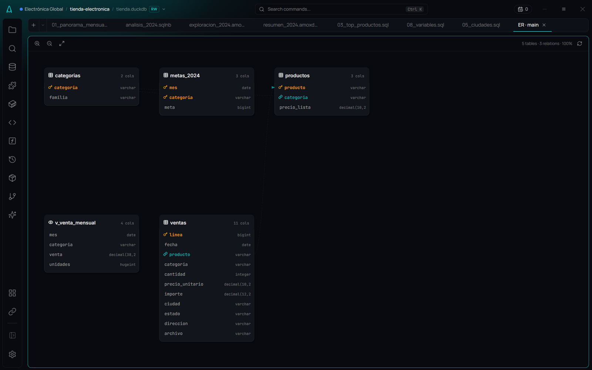
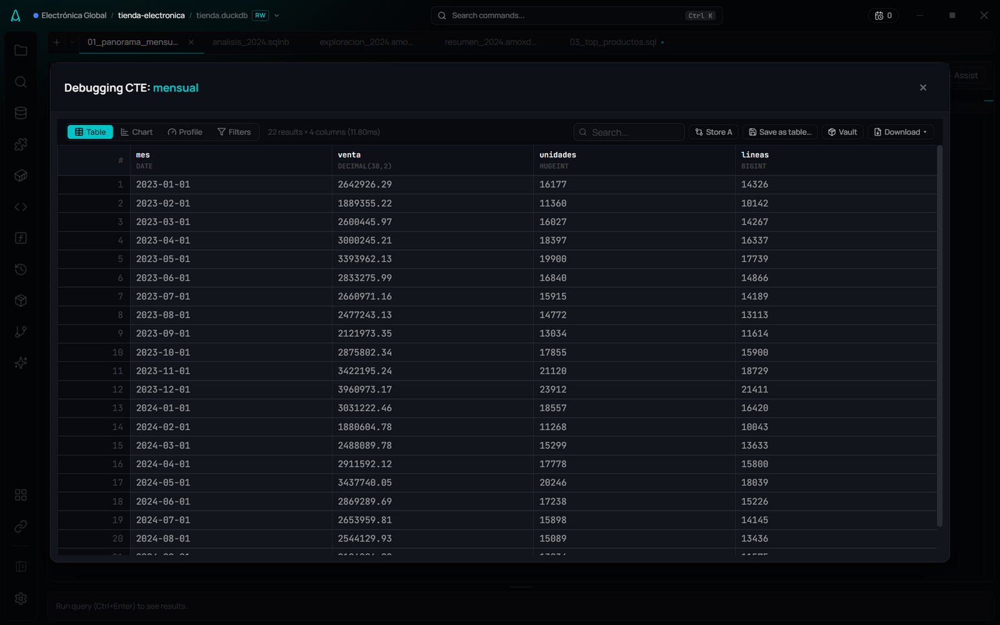
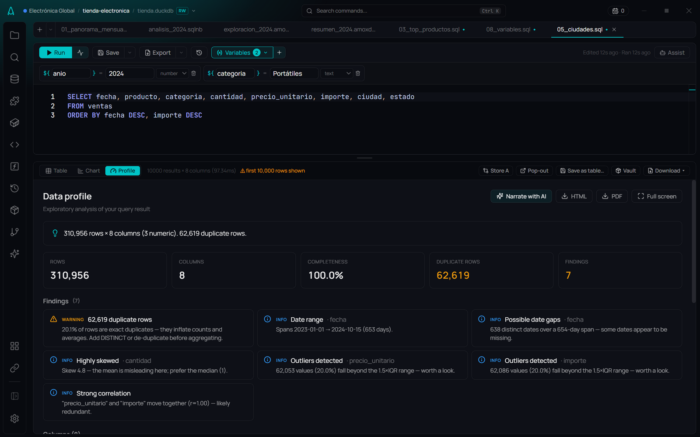
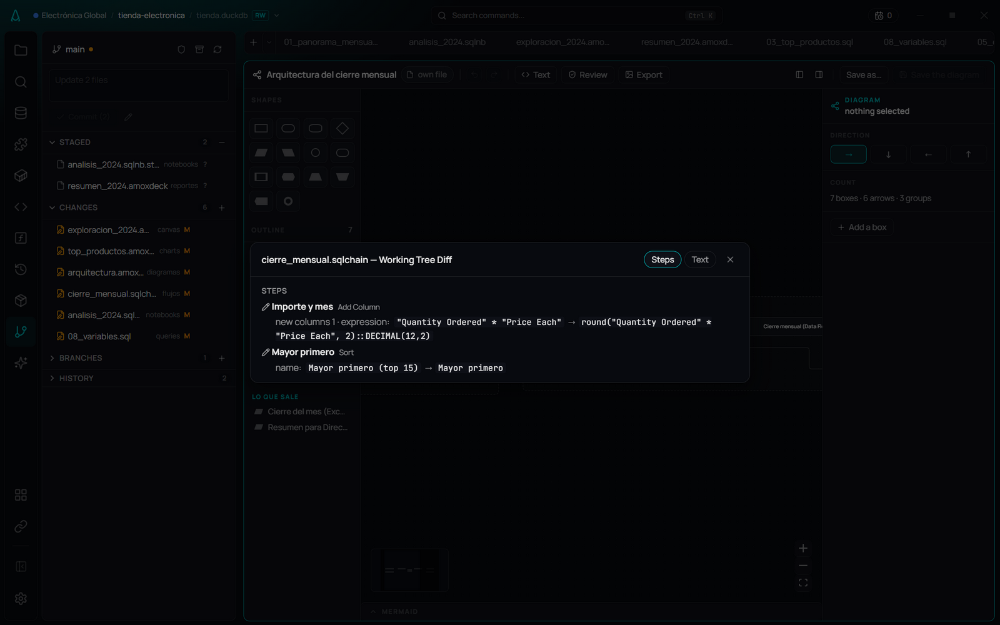

# Example project: the monthly sales close

**🌐 English · [Español](../../es/user-guide/example-project.md)**

> A simulated real case, end to end: an online store sends a sales CSV every month, Finance sends its targets in Excel, and the analyst has to say how the year is going, deliver an Excel workbook to management and leave the close running on its own. Every image in this guide comes from this project.


## The scenario

**Electrónica Global** sells electronics online in ten cities. Its analyst receives:

| What | How it arrives | Where it lives in the project |
|---|---|---|
| The month's sales, one row per line sold | One CSV per month (`Sales_2024_9.csv`), on the 5th of the next month | `datos/ventas-mensuales/` |
| Sales targets by month and category | An Excel workbook from Finance | `datos/metas_2024.xlsx` |

Every month they deliver **an Excel workbook for management**, and before the committee, **a presentation** on how the year is going.

The agency that runs the store's campaigns, **Agencia Digital MX**, is another client of the same analyst, with its own project. Both clients show together in [Workspaces](workspaces.md).

## The projects

| Project | Client | What it shows |
|---|---|---|
| `tienda-electronica` | Electrónica Global | The whole flow: sources, database, queries, notebook, charts, Canvas, deck, a scheduled Data Flow process, a diagram, AI context, Git |
| `marketing-campanas` | Agencia Digital MX | A second client: a media plan by state, a notebook with parameters |
| `almacen-dbt` | Electrónica Global | A dbt project with one model per layer |

```
tienda-electronica/
├── datos/
│   ├── ventas-mensuales/      22 monthly CSVs (Jan 2023 – Oct 2024, 310,956 lines)
│   └── metas_2024.xlsx        Finance's targets
├── queries/                   8 queries, from a quick check to analysis
├── notebooks/analisis_2024.sqlnb
├── charts/                    3 Story Flow charts (.amoxvis)
├── canvas/exploracion_2024.amoxcanvas
├── reportes/resumen_2024.amoxdeck
├── flujos/                    cierre_mensual.sqlchain · publicar_ventas.sqlchain
├── diagramas/arquitectura.amoxdiagram
├── context/                   metrics.yml · joins.yml · glossary.md · examples/
├── RULES.md                   rules for the assistant
├── entregas/                  what the close leaves (one workbook per month)
├── publicado/                 the Parquet other projects read
└── tienda.duckdb
```

The example data and texts are in Spanish, as a real client's would be; the application is in English.

## 1. Read the files where they arrive

The CSV folder is a **[named source](../data/sources.md)**: `ventas-mensuales`. It is queried as `fuentes."ventas-mensuales"` and always brings every month, with nothing copied. It has a **[contract](../data/source-contracts.md)**: its columns and their types, `Quantity Ordered` never empty, and at least a thousand rows. If a month arrives broken, the close stops and says why.

The targets are another source, `metas`, over the workbook. When importing it, AmoxSQL shows the sheet as it is and how it will be read:



## 2. The project database

`tienda.duckdb` holds a small, clean model: `ventas` (each line with its amount), `productos`, `categorias`, `metas_2024` and the view `v_venta_mensual`, with primary and foreign keys and a description per table. The explorer says which files each table came from, and the [ER diagram](../data/er-diagram.md) draws the relationships:



## 3. Explore with queries

`queries/` goes from general to specific: the monthly overview with growth (`01`), the mix by category (`02`), top products (`03`), target vs actual (`04`), cities (`05`), seasonality (`06`), a quality check before delivering (`07`) and an example of [variables](../editor/variables.md) (`08`).



In `01_panorama_mensual.sql`, the ▶ next to each CTE shows its intermediate result. [Autocomplete](../editor/autocomplete.md) knows each alias's columns and the context metrics (`venta_total`, `ticket_promedio`). On any result, **Profile** builds the profile and finds, for instance, that the original CSVs carry duplicate lines:



## 4. Tell it: notebook, charts and Canvas

- **[The notebook](../notebooks/notebooks.md)** `analisis_2024.sqlnb` tells the story in order, with the `anio` parameter: the year against the previous one, the mix by category and target attainment. The last cell is a **draft**: it runs but stays out of Word.
- **[Story Flow](../visualization/story-flow.md)**: the charts in `charts/` carry their own query, title and takeaway.
- **[The Canvas](../notebooks/canvas.md)** `exploracion_2024.amoxcanvas` is the workbench: two branches —by category and by month— come out of the sales table, with their charts, a number and a note.


## 5. Present it

`reportes/resumen_2024.amoxdeck` is the committee deck in [Report Flow](../reports/report-flow.md): a cover, a summary with figures, two findings with their chart, the product ranking and the proposed actions. **Refresh all** re-runs every chart, and **Export PowerPoint** makes it editable.


## 6. Let it run on its own

`flujos/cierre_mensual.sqlchain` is the close in [Data Flow](../data-flow/data-flow.md): it reads the source, computes the amount, filters from the `desde` parameter, groups by month and category and by product, and writes **a two-sheet workbook** to the `entregas-direccion` destination (`entregas/<year>/cierre_<year-month>.xlsx`).


It is [scheduled](../data-flow/scheduling.md) for **the third business day of every month at 07:00**, and `publicar_ventas.sqlchain` runs **when a new file arrives** in the folder and leaves `publicado/ventas-limpias.parquet` for other projects to read by name. **Operations** shows everything scheduled and what already ran:


## 7. For the assistant and for the team

- `context/` gives the AI the metrics (`venta_total`, `ticket_promedio`, `unidades`), how tables join and a glossary; `RULES.md`, how it should answer. See [Context as code](../ai/context-as-code.md).
- `diagramas/arquitectura.amoxdiagram` draws the flow end to end in [AmoxDiagram](../editor/amoxdiagram.md).
- The project is a Git repository: the Git panel and **What changed** show a process's changes as steps, not JSON.



## Create the examples folder

From the AmoxSQL repository:

```bash
node scripts/ejemplos/crearEjemplos.mjs --datos <folder with the sales CSVs>
```

It creates **Ejemplos AmoxSQL** on the desktop, builds the databases, registers the clients, sources, destinations and schedules in a **temporary** AmoxSQL home (never yours) and runs the processes once. What belongs to each project (queries, notebook, charts, processes, Canvas, deck, diagram and context) lives in `scripts/ejemplos/proyectos/`.

> The clients, schedules and run history belong to the script's temporary home. When you open the projects in your AmoxSQL, link them to your own clients from [Workspaces](workspaces.md).

## Related

- [First steps](first-steps.md) · [Workspaces](workspaces.md) · [Projects & connections](projects-and-connections.md)
- [Named sources](../data/sources.md) · [Data Flow](../data-flow/data-flow.md) · [Canvas](../notebooks/canvas.md)
