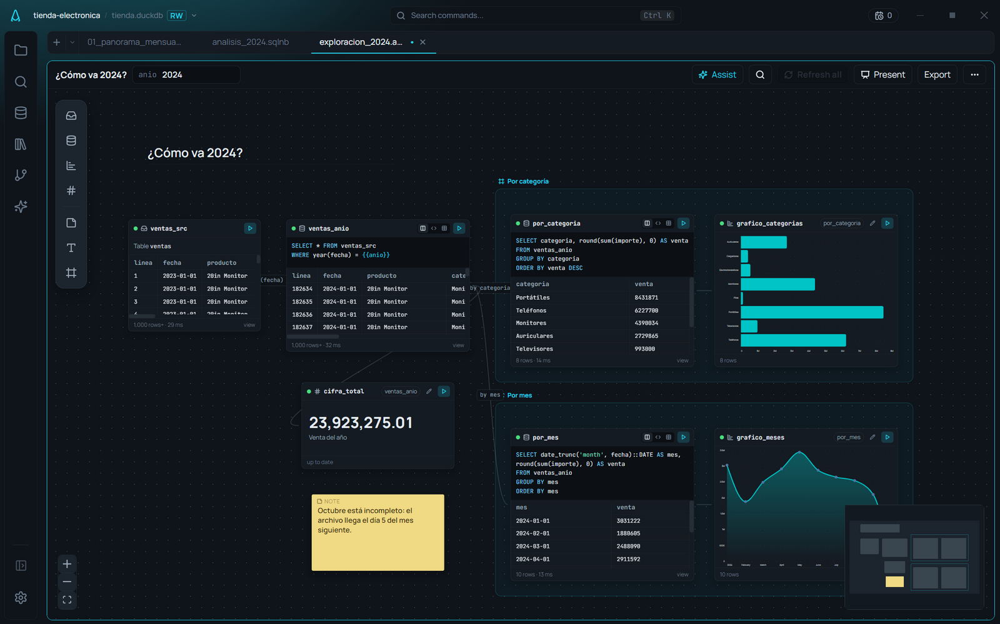
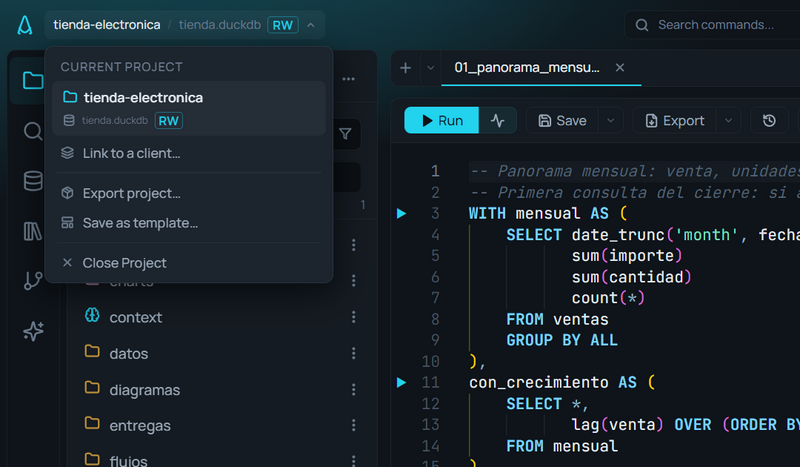
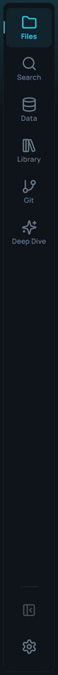
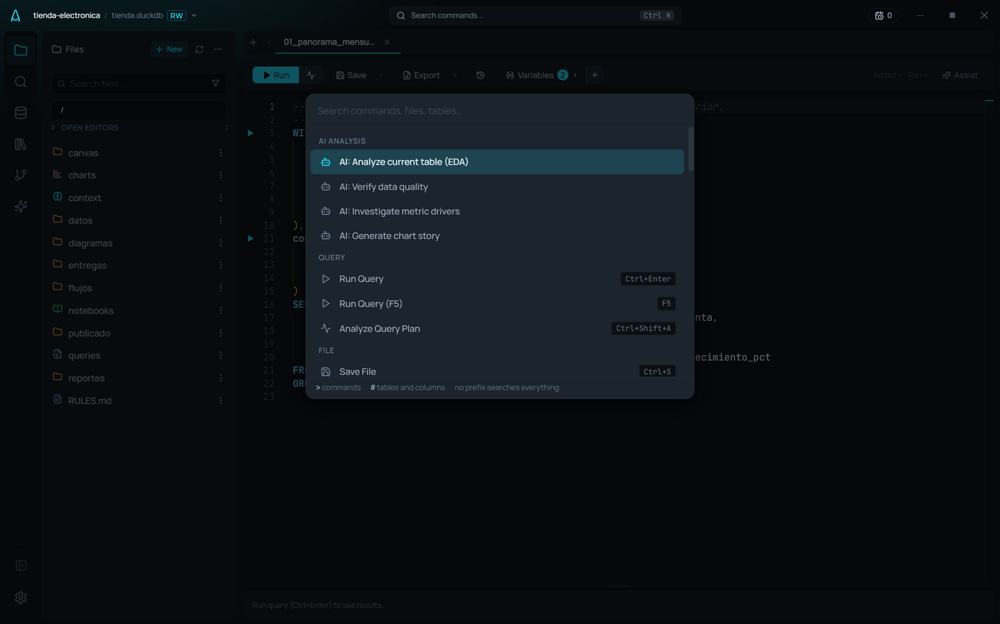

# The interface

**🌐 English · [Español](../../es/user-guide/interface.md)**

> A tour of AmoxSQL's areas: the activity bar, the side panel, the editor area with tabs and split panes, and the command palette.

## Main areas

### Title bar (top)
Shows the **active project** (name · connection mode MEM/RO/RW · database) and window controls. The project widget expands to show recent projects and the option to close it.

### Activity bar (far left)
Seven entries that swap the side panel's content (since 6.0; before, fifteen separate icons):

| Entry | What's inside |
|---|---|
| **Files** | The project [file explorer](../data/file-explorer.md). **+ New** creates any kind of file or a folder; **…** sorts the list |
| **Search** | Search across the project |
| **Data** | The [database explorer](../data/database-explorer.md): sources, destinations, schemas and tables. Folded at the bottom, the [DuckDB extensions](../data/duckdb-extensions.md) |
| **Library** | Four tabs: **Snippets** ([SQL snippets](../editor/snippets.md) and project variables), **Functions** (function reference), **History** ([history](../editor/history-and-bookmarks.md)) and **Saved** ([saved analyses](../ai/analysis-vault.md)). It reopens on the last one you used |
| **dbt** | [DBT Studio](../dbt/dbt-studio.md). Only shown when the folder has a `dbt_project.yml` |
| **Git** | The project's Git status. Only shown when the folder is a repository |
| **Deep Dive** | [Deep agentic analysis](../ai/deep-dive.md) |

At the bottom: fold the side panel (**Ctrl+B**) and **Settings**. The **Chart Gallery** and **New Data Flow** left the bar: they are actions, and they are still in the tabs' "+", on a new file's screen and in the palette (**Ctrl+K**). The palette also opens each panel directly (for example "Show Query History", or "Show DBT Studio" even before the folder is a dbt project).

To see each icon's name under it: **Settings → Appearance → Activity Bar → Show names under the icons**. Shortcuts did not change (**Ctrl+Shift+E** files, **Ctrl+Shift+F** search, **Ctrl+Shift+D** data).

### Editor area (center)
This is where **tabs** live. Each tab is a file (`.sql`, `.sqlnb`, `.sqlchain`, `.md`, `.amoxdeck`, `.amoxvis`) or a special view (Deep Dive, ER diagram, DBT lineage). You can:

- **Split into two panes** and drag tabs between them (see [Layout, tabs & panes](../editor/layout-tabs-and-panes.md)).
- Edit SQL with results below (see [SQL editor](../editor/sql-editor.md)).

<!-- 📷 CAPTURE: docs/images/user-guide/split-view.png — split view with two panes -->

### Results panel (below the editor)
Appears when you run a query. Toggle between **Table**, **Chart**, and **Profile**. See [Results table](../results/results-table.md).

## Command palette

**Ctrl+Shift+P** opens the palette: search and run any action (run query, save, switch theme, open panels, zoom, tours…). It's the fastest way to reach any feature without remembering where it lives. See [Command palette](../editor/command-palette.md).

## Appearance

The theme (light/dark; since 6.0 a new install starts on **Amox Dark**), accent color, typography, and zoom are set in **Settings → Appearance**. See [Themes & appearance](themes-and-appearance.md).

## Related
- [First steps](first-steps.md) · [Projects & connections](projects-and-connections.md)
- [Layout, tabs & panes](../editor/layout-tabs-and-panes.md) · [Command palette](../editor/command-palette.md)
- [Keyboard shortcuts](../reference/keyboard-shortcuts.md)
