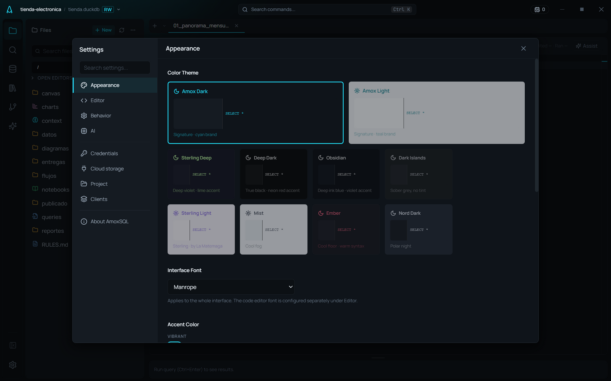
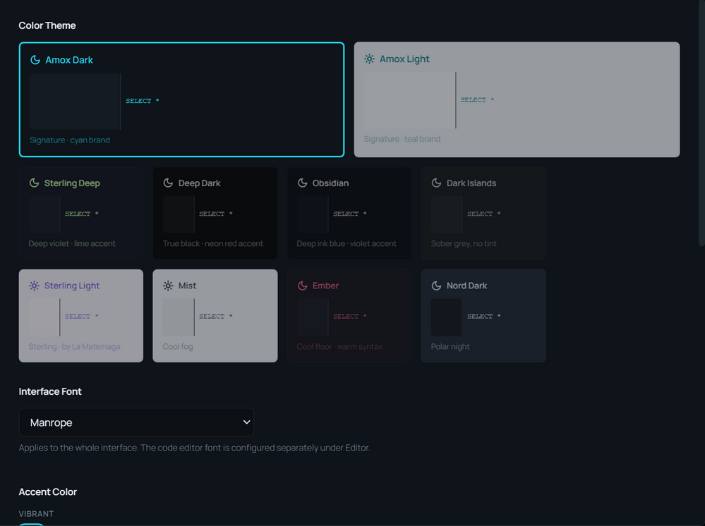

# Themes & appearance

**🌐 English · [Español](../../es/user-guide/themes-and-appearance.md)**

> AmoxSQL ships 10 themes (light and dark), each with its own accent, and 16 more accents to choose from, with the code editor and charts following your choice live.

## Where to set it
**Settings → Appearance** (gear icon in the activity bar, or Ctrl+,).

## Themes (10)

A new install starts on **Amox Dark** (since 6.0); if you had already chosen another theme, yours stays.

| Theme | Mode | What it is | Its accent |
|---|---|---|---|
| **Amox Dark** | Dark | The house theme: cool carbon | Brand cyan |
| **Amox Light** | Light | The house light theme | Brand teal |
| **Sterling Deep** | Dark | Violet grey | Lime |
| **Sterling Light** | Light | Lavender paper, violet ink | Violet |
| **Obsidian** | Dark | Blue-black, the deepest with a tint | Violet |
| **Deep Dark** | Dark | Untinted black: the data is the only colour | Neon red |
| **Ember** | Dark | Neutral floor, warm code | Coral |
| **Dark Islands** | Dark | Sober grey | Blue |
| **Nord Dark** | Dark | Polar night, all muted | Frost blue |
| **Mist** | Light | Cool fog, low glare | Indigo |

All are calibrated to the same contrast floors (WCAG accessibility), so text is legible in any of them. Amox Dark and Amox Light are the brand themes.

## Accent colors
The accent tints buttons, highlights, links, and active elements.

- **Theme** (the first swatch): the accent the theme brings, the one in the table above. It is the default, and it follows you when you change theme.
- **10 vibrant:** Cyan, Blue, Violet, Magenta, Pink, Neon red, Orange, Yellow, Lime, Green.
- **6 muted:** Sage, Sand, Clay, Mauve, Steel, Graphite (an accent with no colour).

Each accent has a darker version for light themes, so it reads both as text and as a button. With **Neon red** on a dark theme, errors turn vermilion, so a primary button is never mistaken for a delete one.

If you had picked an accent that is gone, it switches by itself to the closest one: Rose to Clay, Lavender to Mauve, Amber and Copper to Sand.

## The editor and charts follow your theme
- The **code editor** adopts the active theme and accent live — no reload.
- **Charts** generated by the AI take the active theme into account (light/dark background and accent) to choose palettes that read well on your canvas (see [AI accuracy & guardrails](../ai/accuracy-and-guardrails.md)).

## Other appearance settings
| Setting | What it does |
|---|---|
| **Editor layout** | Horizontal (default) or Vertical (for ultrawide monitors) |
| **Interface typography** | UI font |
| **UI zoom** | Overall interface scale (Ctrl += / Ctrl +- / Ctrl +0) |

Code-editor-specific options (code font, minimap, word wrap, etc.) are in **Settings → Editor**; see [SQL editor](../editor/sql-editor.md) and [Configuration](../reference/configuration.md).

## Related
- [The interface](interface.md) · [Configuration](../reference/configuration.md)
- [SQL editor](../editor/sql-editor.md)
