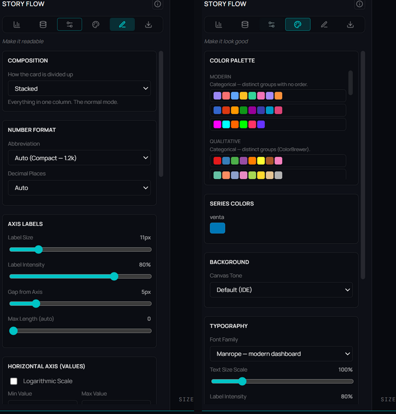

# Format & style

**🌐 English · [Español](../../es/visualization/format-and-style.md)**

> The two stages that make the chart readable and then good-looking: Format tunes numbers, axes, grid, legend, labels, tooltip, marks and interaction; Style applies palette, series names, typography and the card.

## What it is

**Format** ("Make it readable") and **Style** ("Make it look good") are stages ③ and ④ of [Story Flow](story-flow.md). Format is the mechanics: values that read without effort. Style is the finish. Each panel shows only what the active type can draw —a donut has no axes, a scatter has zoom—, and everything you change here is written into the figure's Vega-Lite (you see it in **Code**).

## When to use it

- **Format**: when numbers overlap, the scale misleads, labels are missing, or the tooltip doesn't say enough.
- **Style**: when the chart goes into a report or deck and needs a palette, typography and frame consistent with the rest.

## How to use it

The sections follow the order in which a figure is read: numbers first, then axes, then the details.

### Format — readability
1. **Numbers** — the format (compact, currency, thousands, millions, percentage…) and decimals. It applies to axes, labels, tooltip and KPI.
2. **Value axis** — the scale (linear, logarithmic or square root), whether it starts at zero (automatic, always, never) and the min and max. With a right axis (set in **Data**), its range is here too.
3. **Axis titles & labels** — each axis title, the rotation of the category labels, their size, max length, gap and intensity.
4. **Grid & legend** — grid, axis lines and the legend. With the legend at the top, bottom or a side you can turn on **Click the legend to highlight a series**: a click on a series dims the rest.
5. **Labels & tooltip** — values on the marks (on bars, outside or inside; on a donut, what they say and where), what the tooltip adds (**% of total** or **change vs previous**), and **Also show in the tooltip**, to add result columns.
6. **Marks** — what belongs to the type: **Lines** (smooth, straight or step; points; fill), **Bars** (side by side, stacked or 100 %; color; radius), **Donut** (hole size and what goes in the center), **Scatter** (quadrants), **Combo** (which series are lines).
7. **Interaction** — **Zoom and pan**: automatic (scatter and long date series), always or never. Wheel to zoom, drag to pan, double-click to reset.

### Style — appearance
1. **Color Palette** — pick a palette by its purpose (categorical, sequential, diverging, brand).
2. **Series: colors & names** — each series' color, **the name it shows in the legend** and, for lines, the stroke (solid, dashed, dotted).
3. **Fill** — for lines and areas, gradient or solid.
4. **Typography** — font and text scale.
5. **Card** — how the card is laid out (**Layout**), background, shadow, radius, gradient and border.

## Reference — Format stage

| Section | Option | Values |
|---|---|---|
| Numbers | Format · Decimals | Auto (compact) · Standard · Currency · Thousands · Millions · Billions · Percentage · Raw · Auto/0–4 |
| Value axis | Scale | Linear · Logarithmic · Square root |
| | Start at zero | Automatic · Always · Never |
| | Min / Max | Empty = automatic; also for the right axis |
| Axis titles & labels | Category / Value axis title | Text + show |
| | Category label rotation | 0° · 45° · 90° |
| | Label size · Max label length · Gap · Intensity | 8–24 px · 0 = auto · 0–30 px · 20–100 % |
| Grid & legend | Grid lines · Axis lines | Both · Horizontal · Vertical · None |
| | Legend | In the subtitle · Top · Bottom · Left · Right · Hidden |
| | Click the legend to highlight a series | With the legend in the figure and several series |
| Labels & tooltip | Values on the marks · Label position · Label size | Bars: Outside · Inside the bar |
| | Content · Position (donut) | % · value · name · name + % · name + value; outside/inside |
| | Tooltip | Value · Value + % of total · Value + change vs previous |
| | Also show in the tooltip | Result columns (on charts that add up, numeric only, summed) |
| Lines | Shape · Points · Fill | Smooth · Straight · Step · Step before · Step after |
| Bars | Layout · Color · Corner radius | Side by side · Stacked · Stacked to 100 % · One color · Per category · Intensity |
| Donut | Hole size · In the center | 20–85 % · Nothing · Total · Average |
| Scatter | Quadrants | The mean of each axis |
| Combo | Line series | Which series are lines |
| Interaction | Zoom and pan | Automatic · Always · Never |

## Reference — Style stage

| Section | Option | Values |
|---|---|---|
| Color Palette | Groups | Modern · Qualitative · Sequential · Diverging · Brand · Sterling |
| Series: colors & names | Color · Name in the legend · Stroke | Per series (per slice on a donut); stroke on lines: Solid · Dashed · Dotted |
| Fill | Area fill | Gradient · Solid |
| Typography | Font family · Text size scale | 8 fonts · 75–200 % |
| Card | Layout · Background · Drop shadow · Corner radius · Gradient · Border | Stacked · Side by side · Automatic; background tones; 0–28 px; None · Solid · Dashed · Subtle |

## Tips & gems

- **What you write in code comes back to the panels:** change an axis title or the scale in **Code** and the panel shows it. What the panels can't represent stays marked (see [Story Flow](story-flow.md#the-code-is-in-charge)).
- **Name your series:** "Total cost" in the legend instead of `costo_total`, without touching the query.
- **A legend you use:** with several series, "Click the legend to highlight a series" lets you read one without another chart.
- **Fix the axis to compare:** if several charts are read together, fix min and max so their scales match.

## Related

- [Story Flow](story-flow.md) · [Chart types](chart-types.md)
- [Storytelling & overlays](storytelling-and-overlays.md) · [Exporting charts](exporting-charts.md)
