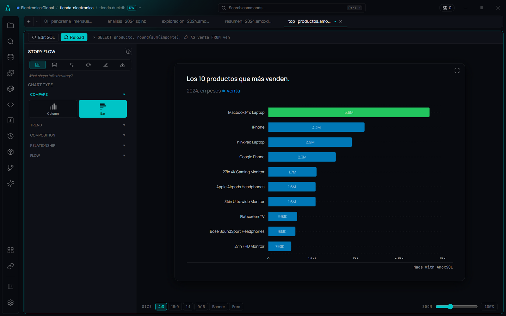

# Story Flow

**🌐 English · [Español](../../es/visualization/story-flow.md)**

> AmoxSQL's visualization section: turn a query result into a chart that says something, guided through six stages — from "what shape tells the story?" to "ship it".

## What it is

**Story Flow** is AmoxSQL's visualization layer. It isn't a "pick a chart and go" panel; it's organized as the natural sequence of telling a story with data: six stages, left to right, each doing one job. You edit a chart on top of a query result without leaving the IDE, and the local engine (DuckDB) feeds the chart directly — no data leaves your machine.

The six stages are tabs in the panel's sidebar:

1. **Type** — "What shape tells the story?" Pick the type by what you want to communicate (see [Chart types](chart-types.md)).
2. **Data** — "What goes where?" Map columns onto channels (X, Y, color/split, size, secondary axis) and shape the data (sort, top-N, date aggregation).
3. **Format** — "Make it readable." Axes, number format, grid, legend, labels, and tooltips (see [Format & style](format-and-style.md)).
4. **Style** — "Make it look good." Palettes, per-series colors, typography, card and background.
5. **Story** — "Make it speak." Title/subtitle/takeaway, headline KPI, annotations, goal/reference lines, trend and focus (see [Storytelling & overlays](storytelling-and-overlays.md)).
6. **Export** — "Ship it." PNG at several sizes, copy to clipboard, and save the configuration as `.amoxvis` (see [Exporting charts](exporting-charts.md)).

The figure is drawn with **Vega-Lite**, the open grammar of graphics, and saved as an **`.amoxvis`** file: a valid Vega-Lite spec that **carries its own query** inside. That's why an `.amoxvis` can re-run on its own (when you open it) or inside a [Report Flow](../reports/report-flow.md) deck, refreshing the chart with current data without redoing the analysis.

## When to use it

- When you already have a result on screen and want to see it as a chart instead of a table.
- To prepare a chart you'll reuse: save it as `.amoxvis` and drop it into a deck or refresh it later.
- When you want the AI to propose a chart and then fine-tune it by hand (see the live-update hook below).
- If you only need to explore values row by row, stay in the [Results table](../results/results-table.md); for descriptive statistics, use the [Data Profiler](../results/data-profiler.md).

## How to use it

### Open the chart from a result
1. Run a query in the [SQL editor](../editor/sql-editor.md) or in a [Notebook](../notebooks/notebooks.md).
2. In the results panel, switch from **Table** to **Chart** with the view toggle in the top bar.
3. Story Flow appears with the chart and the six-stage sidebar. AmoxSQL preselects sensible axes from the columns.

### A `.sql` file remembers its chart
The chart you build on the result of a saved `.sql` is **a view of that query**: there is nothing to save. Switch tabs, close the file, come back tomorrow: when you run it again, the result shows up the way you left it (table or chart, with its settings). Under the Story Flow header it says so: **Kept with sales.sql**.

It is kept in the project's `.amoxsql/borradores/`, which git ignores and which doesn't travel in the `.amoxproject`: it's how you look at the query on this machine. Rename or move the `.sql` and the chart goes with it. A new, unsaved tab keeps it while it's open; once you save it as a `.sql`, it starts being remembered.

### Save as chart
When the chart has to live on its own — in a [Report Flow](../reports/report-flow.md) deck, on the Canvas, to share it — save it as a document: on a result, the header's **Save** button is **Save as chart…**. It suggests `sales.amoxvis` next to the `.sql` and opens it in its own tab when saved. The `.amoxvis` stays **linked** to the query: the `.sql` results show it as **Saved as sales.amoxvis** (one click opens it).

### Open an `.amoxvis` file
1. Double-click an `.amoxvis` file in the [File explorer](../data/file-explorer.md).
2. It opens in its own tab: it runs the query and shows the chart.
3. The bar at the top says **where the query comes from**:
   - `sales.sql › sales.amoxvis` — the query lives in `sales.sql`. Click its name to edit it there; **when you save the `.sql`, the chart follows** (even if the chart is closed — and the deck that uses it with it). If the file has several queries and it's no longer clear which one the chart used, it asks you which to follow when you open it, or **Unlink** to make the query the chart's own.
   - `sales.amoxvis · Own query` — the query belongs to the chart. **Query** unfolds it in the same tab: write it, **Run** (Ctrl+Enter) runs it and **Ctrl+S saves the `.amoxvis`**. **Move to a .sql file…** moves it to a new file and leaves the chart linked.
4. **Ctrl+S always saves the file whose name you see on the tab**: on the chart's tab, the `.amoxvis`; on the `.sql` tab, the `.sql`.
5. **Refresh** runs the query again with today's data. From the explorer, **Edit query** opens the chart with its query in view.

### Walk the stages
1. Start at **Type** and pick the shape; then move through **Data → Format → Style → Story → Export**.
2. The order isn't mandatory: each tab is independent and changes render live.
3. Each tab's footer shows a short hint ("What goes where?", etc.) to orient you.

### The code is in charge
The sidebar header has the **Panels | Code** switch, the **Save** button (always visible; on an `.amoxvis` it saves the file, on a result it is **Save as chart…**) and the guide.

**Panels** and **Code** are two ways to edit **the same figure**, not two modes:

- **The panels write the Vega-Lite.** Every change in a stage shows up in **Code**.
- **The code comes back to the panels.** If in **Code** you change the mark type, a column, an axis title, the scale, the sort, the grid, the goal or the reference line, the matching panel shows it. Removing the goal layer turns "Goal Line" off.
- **What the panels can't represent is kept and marked.** A hand-written layer, an opacity, your own `config`… stay in the figure even if you then change the panels. At the foot of the panels you get **This chart has N settings written in code**, with the list, **Show in code** and **Remove custom code**. In **Code**, those lines are marked in **amber** in the margin.
- **The code always wins:** what is drawn is exactly what is written.
- **An error doesn't wipe the figure.** If the JSON is half written or Vega-Lite can't read it, the last good figure stays and the error shows under the editor. The editor validates against the Vega-Lite schema and completes as you type.
- The data arrives under the name `dataset` (`"data": {"name": "dataset"}`). The title and takeaway live in **Story**; a `title` written in the code moves to the card.
- **Add layer…** (above the editor) adds a ready-made layer: **Mean line**, **Median line**, **Value labels**, or **Regression line**.
- An `.amoxvis` edited outside AmoxSQL (in another editor) is recognized on open and read the same way: the panels take what they understand and the rest stays as your own code.

### The guide and the tour
- The **?** button (info icon) in the panel header opens a drawer with the **Story Flow guide**: it explains the six stages and the storytelling principles. The same guide lives in Settings → Story Flow.
- The first time you open Story Flow a **welcome tour** starts (a carousel through the six stages). You can replay it from the guide.

### Live update from the AI
When the [AI Assistant](../ai/editor-assistant.md) draws or adjusts a chart, Story Flow listens for that change and **merges** the AI's configuration into yours without overwriting the axes or fields you already picked. So you can ask for a chart and keep refining it by hand.

### Fullscreen
The maximize button (top-right of the chart area) takes the chart full-screen; in that mode a **PNG** button also appears for an instant download.

## Reference

### The six stages
| Stage | Hint | What it controls | Page |
|---|---|---|---|
| **Type** | What shape tells the story? | Chart type (17, grouped by intent) | [Chart types](chart-types.md) |
| **Data** | What goes where? | X/Y/split/size/2nd-axis channels, sort, top-N, date aggregation | this page |
| **Format** | Make it readable | Axes, number format, grid, legend, labels, tooltips | [Format & style](format-and-style.md) |
| **Style** | Make it look good | Palette, per-series colors, typography, card, background, border | [Format & style](format-and-style.md) |
| **Story** | Make it speak | Title/takeaway, KPI, annotations, goal/reference lines, focus, trend | [Storytelling & overlays](storytelling-and-overlays.md) |
| **Export** | Ship it | PNG by size, clipboard, `.amoxvis`, paste JSON | [Exporting charts](exporting-charts.md) |

### Data stage
| Section | Option | What it does |
|---|---|---|
| Columns | Category (X) · Values (Y) | The dimension and one or more measures (with "Color by", just one) |
| | Interval low/high · Band low/high | The interval of bars with interval; a band under the line |
| | Color by | One series per value of the column |
| | Size by | Point size (scatter) |
| | Right axis | One of the Y columns on its own scale, on the right |
| Shape the data | Group dates by | Day · week · month · quarter · year |
| | Running total | Cumulative total (lines and areas) |
| | Sort by · Top | Order and, on rankings, how many to show |
| Small multiples | One chart per · Charts per row | The same figure repeated for each value of a column |
| Per type | Bins · mean/median · Orientation · Small slices | Histogram; box, strip, interval, lollipop, dumbbell; donut |

## Tips & gems

- **The `.amoxvis` is self-contained:** it stores the figure *and* the query, so the chart can regenerate itself — the basis of a Report Flow deck that refreshes.
- **The `.amoxvis` isn't locked in:** it is a valid Vega-Lite spec. What belongs to AmoxSQL (the query, the state of the panels) goes in `usermeta`, a field Vega-Lite reserves for that and every other tool ignores.
- **Totals come from every row:** the editor shows at most the first 10,000 rows of a result. If the result was cut and the chart adds up by X (bars, lines, areas, donut, funnel, waterfall…), DuckDB does that sum over the whole query and the canvas bar says so: **Totals from all rows (DuckDB)**. Scatter, histogram and box plot draw the rows there are.
- **Zoom:** on a scatter, and on a date series with many points, the wheel zooms and dragging pans; double-click resets.
- **Your axes survive re-queries:** when you re-run a query with different columns, Story Flow only fills axes that are missing or no longer valid; your manual pick is kept as long as its column still exists.
- **The AI doesn't clobber your work:** an AI proposal is merged onto your current config, not replaced.
- **The theme follows your settings:** the chart adopts the active theme and accent color.

## Related formats

- `.amoxvis` — a Vega-Lite spec with an embedded query (see [File formats](../reference/file-formats.md)).

## Related

- [Chart types](chart-types.md) · [Storytelling & overlays](storytelling-and-overlays.md)
- [Format & style](format-and-style.md) · [Exporting charts](exporting-charts.md)
- [Report Flow (decks)](../reports/report-flow.md) · [Results table](../results/results-table.md)
