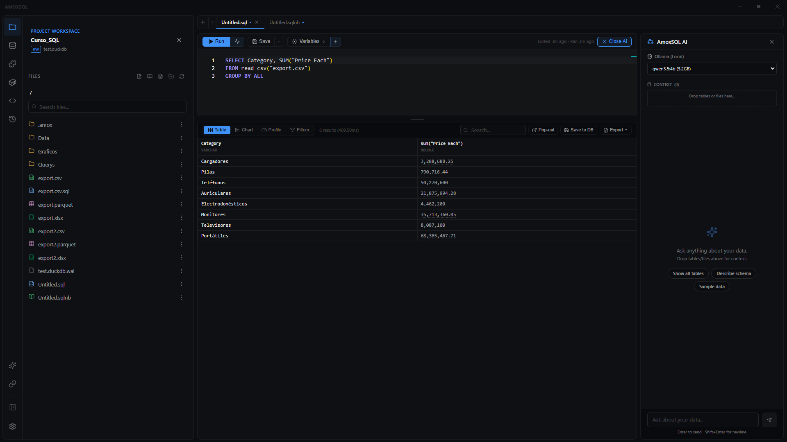

# Asistente del editor

**🌐 [English](../../en/ai/editor-assistant.md) · Español**

> Tu copiloto en el editor: una barra lateral compacta, ligada al archivo abierto, que genera, explica y arregla SQL, y propone gráficos — todo sobre la query que tienes delante.

## Qué es

El Asistente es el modo de IA de menor autonomía y mayor cercanía. Vive en una barra lateral junto al [editor SQL](../editor/sql-editor.md) o al [notebook](../notebooks/notebooks.md), y siempre está **ligado al archivo activo**: ve tu query actual, el último resultado y el gráfico configurado, así que sus respuestas son sobre lo que estás haciendo, no en abstracto.

Es reactivo y conversacional pero compacto: abre con el hallazgo, teje los números en la frase y cierra con el siguiente paso. Tú conduces; él ayuda. Cuando una pregunta merece un análisis completo sobre toda la base de datos, promuévela a [Deep Dive](deep-dive.md) con un botón.

## Cuándo usarlo

- Estás escribiendo SQL y quieres generarlo, explicarlo u optimizarlo.
- Una query falla o devuelve algo raro y quieres entender por qué.
- Tienes un resultado y quieres graficarlo bien de un tirón.
- Para un análisis narrado y autónomo sobre **toda** la base, usa [Deep Dive](deep-dive.md) en vez del Asistente.

## Cómo usarlo

### Abrir el Asistente
1. Abre un archivo. El botón **Assist** está en el editor SQL, el notebook, Markdown, Report Flow, la cabecera de Story Flow, el Canvas y el diagrama, y en Data Flow es la barra de abajo; **Ctrl+L** lo abre sobre cualquier archivo.
2. Escribe tu pregunta y envía con **Enter**.

El Asistente sabe qué archivo tiene delante (una consulta, un notebook, un deck, un gráfico, un Data Flow…) y lo trata como tal.
Mira la tabla [Qué puede cambiar en cada archivo](#qué-puede-cambiar-en-cada-archivo).

### Generar, explicar u optimizar SQL
1. Con la query en el editor, pídele *"explica esta query"*, *"optimízala"* o describe lo que quieres obtener.
2. El Asistente responde en prosa y, cuando propone cambiar el archivo, muestra la propuesta.

«Esto» es lo que tienes delante: el texto seleccionado si hay selección; si no, la sentencia donde está el cursor. Un archivo con varias consultas ya no se trata como una sola.

### Preguntar por una parte del archivo
1. Selecciona en el editor más de una palabra. Debajo aparece una barra pequeña: **Explain · Fix · Optimize · Ask…** en SQL, **Explain · Improve · Ask…** en un archivo de texto y **Rewrite · Shorter · Explain · Continue · Ask…** en Markdown (la barra de formato sigue encima de la selección).
2. **Explain**, **Fix**, **Optimize** e **Improve** envían la pregunta sobre esa selección. **Ask…** (o **Ctrl+L** con texto seleccionado) abre la caja para que escribas tu pregunta.
3. Mientras hay selección, la caja del chat la muestra: *Selection · lines 18–20*.
4. **Escape** cierra la barra hasta que cambies la selección.

### En un notebook
El Asistente sabe en qué celda estás, y ve su resultado o su error, las demás celdas (con lo que lee cada una), las vistas que ya dejaron en la sesión y los parámetros con su valor.

- En el canalón de cada celda, el mando **Assist** abre un menú. En una celda SQL: **Explain this cell**, **Fix the error** (si falló) y **Chart the result** (si tiene resultado). En una de texto: **Write from the result above** (si la celda de encima tiene resultado) e **Improve this text**.
- Cuando una celda falla, junto a su error aparece **Fix with Assist**.
- Una celda de texto vacía bajo un resultado ofrece **Write from the result above**.

Propone **celda a celda**, nunca el cuaderno entero: el cambio de una celda aparece debajo de ella, con lo que sale y lo que entra; una celda nueva aparece como **fantasma** (con borde discontinuo) en el sitio donde entraría. Las dos se aceptan o se rechazan ahí mismo o desde el chat. Aceptar no toca las demás celdas ni sus resultados.

### En Report Flow
El Asistente sabe en qué lámina estás, y ve el deck lámina a lámina (su diseño, su texto, sus notas) y, de cada gráfico, qué tipo es, qué ejes tiene y de qué consulta sale.

- En la barra de la lámina, **Assist** abre un menú: **Tighten the text**, **Write the headline from the chart** (si la lámina tiene un gráfico), **Speaker notes** y **Add a slide after**.

Propone **lámina a lámina**, nunca el deck entero: el diseño, el texto, los gráficos y las notas de una lámina, o una lámina nueva. La lámina con una propuesta lleva la marca del Asistente en el esquema; una lámina nueva aparece como **fantasma**, con borde discontinuo, en el hueco donde entraría. Sobre la lámina, una barra con **Before** / **Proposal** te deja ver cómo está y cómo quedaría, y **Accept** / **Reject**. Aceptar no toca las demás láminas ni la cabecera, y **Ctrl+Z** lo deshace.

### En un gráfico
El Asistente sabe en qué etapa de Story Flow estás (Type, Data, Format, Style, Story, Export, o la vista Code), y ve el tipo de gráfico, los paneles que elegiste, la consulta, sus columnas y unas filas de muestra.

- En la cabecera de Story Flow, **Assist** ofrece primero la pregunta de tu etapa: *Which chart tells this best?* en Type, *Write the takeaway* en Story, *Make it readable in a slide* en Style…
- **Auto Story**, en la etapa Story, ya no escribe encima de tus textos: propone el título, el subtítulo, la nota y el takeaway, y tú los aceptas o los rechazas.

Propone **cambios de paneles** (el tipo, los ejes, el resalte, los textos…), los mismos que tocarías tú, nunca el JSON del archivo. Un panel que ese tipo de gráfico no dibuja no se propone. Encima de la figura, **Before** / **Proposal** te enseña el gráfico como está y como quedaría, con la lista de lo que cambia (*Type: area → line · Highlight: max*). En la vista **Code** puede proponer un Vega-Lite entero.

### En Data Flow
La barra de abajo del lienzo **es el Asistente de este archivo**: lo que escribes ahí va a la misma conversación del panel, con el paso que tengas seleccionado. El Asistente ve los pasos en orden (qué lee cada uno y su configuración, sin posiciones), los parámetros y, del paso seleccionado, su error si falló.

- En el menú de un paso (**…** o clic derecho): **Explain this step**, **Write the SQL for this step** y, si falló, **Fix with Assist**.

Propone **operaciones sobre los pasos**: añadir, cambiar la configuración, quitar, conectar o desconectar. Antes de enseñártelas se comprueba que los tipos de paso existan y que no haya ciclos. Sobre el lienzo, los pasos nuevos aparecen como **fantasmas** con borde discontinuo junto a lo que leen, los que cambian resaltados, los que se quitan atenuados, y las conexiones nuevas en discontinuo; arriba, la lista de cambios (la misma de **What changed**) con **Before** / **Proposal**, **Accept** y **Reject**. Aceptar no mueve los pasos que se quedan ni pisa los que añadiste después.

### En un Canvas
El Asistente sabe qué tarjeta tienes seleccionada y ve las tarjetas con su SQL o su texto y lo que lee cada una. **Nunca ve las fotos**; de la tarjeta seleccionada recibe sus filas como cualquier resultado, con la política de IA del workspace.

- **Assist**, en la barra del Canvas: **Ask about this card**, **Explain this number** (en una tarjeta Number) y **Ask a question → cards…**, cuya respuesta llega como tarjetas nuevas.

Propone **una tarjeta a la vez**: cambiar el SQL de una consulta o el texto de una nota, o añadir una tarjeta (una consulta que lee otras, una nota, un texto) junto a otra. Se ve como una **tarjeta fantasma** sobre el lienzo: la nueva donde entraría, el cambio debajo de su tarjeta con lo que sale y lo que entra.

### En un diagrama
El Asistente ve el diagrama como cajas, flechas, grupos y capas, y la caja que tengas seleccionada.

- **Assist**, en la barra del diagrama: **Draw with Assist…** (describe lo que quieres, o nombra un `.sql` o un `.sqlchain` para dibujarlo), **Expand this step** (con una caja seleccionada) y **What is missing?**.

Propone el diagrama entero, pero **como grafo**, nunca como texto mermaid: el editor lo escribe con su propio formato, así que siempre se puede seguir editando visualmente, y los colores de las capas (`classDef`) se conservan. **Before** / **Proposal** lo dibuja con las cajas nuevas marcadas.

### Arreglar un error
Cuando una consulta falla, junto al mensaje de error aparece **Fix with Assist**. El Asistente ya sabe el error y la consulta: no hace falta pegar nada. Al empezar una conversación con la consulta en error, la primera sugerencia es **Fix the error**.

### Preguntar por un resultado
En la barra de resultados de un `.sql`, **Explain** pregunta qué destaca y **Chart it** pide un gráfico de ese resultado.

### Aceptar o rechazar una edición
En un `.sql` o un archivo de texto, el Asistente propone **solo las líneas que cambian**, y el cambio se ve **en el propio editor**: lo que sale, en rojo en su línea; lo que entra, en verde debajo; encima, una barra con **Accept** / **Reject**. Mientras está pendiente, esas líneas no se pueden editar. Si escribes en otra parte del archivo, la propuesta sigue a sus líneas. **Review**, en el chat, te lleva a ella.

En Markdown funciona igual, en la vista **Escribir** o **Dividido**. En la vista **Leer**, un aviso dice que hay una propuesta y **Show it** la abre en la vista dividida.

En todos los archivos:

1. **Accept** pone el cambio en el editor **sin guardarlo en disco** — tú revisas y guardas (Ctrl+S). **Reject** lo descarta. En el chat, cada propuesta tiene también **Accept** / **Reject** y **Review**, que te lleva a ella.
2. Lo que decidiste se recuerda: al reabrir la conversación, el bloque dice **Applied to the editor** o **Rejected**.
3. Si esa parte del archivo cambió desde que se hizo la propuesta (sus líneas, su celda, su lámina, esos paneles), aceptarla borraría lo que hiciste después. Por eso no se aplica: el bloque lo dice y ofrece **Propose again**, que se la pide de nuevo sobre la versión actual.

### Crear un archivo nuevo
Si le pides algo que va en otro archivo (*"guárdame esta consulta en un archivo"*), el Asistente propone la ruta y el contenido. Nada se escribe hasta que pulsas **Create**, que crea el archivo y lo abre. Nunca sobrescribe uno que ya exista.

### Insertar una consulta del chat
Bajo cada bloque SQL del chat, **Insert at cursor** pone la consulta donde está el cursor del editor, o sobre el texto seleccionado si hay selección. El resto del archivo no se toca y **Ctrl+Z** lo deshace. También tienes **Copy** y **Run**.

### Aplicar un gráfico
1. Sobre un resultado de un `.sql`, pide *"grafica esto por región"* o similar.
2. El Asistente propone un gráfico completamente configurado; pulsa **Apply to chart** para llevarlo al gráfico de los resultados de esa consulta, en [Story Flow](../visualization/story-flow.md). Solo cambia ese gráfico, no los de otras pestañas.

### Añadir contexto (drag & drop)
Arrastra una tabla del [explorador de base de datos](../data/database-explorer.md) o un archivo del [explorador de archivos](../data/file-explorer.md) y suéltalo en el chat. Queda como contexto de la conversación y se envía en cada pregunta.

### Elegir modelo y skill
En la barra inferior del chat eliges el **modelo** (ver [Proveedores y modelos](providers-and-models.md)) y, si tu proyecto trae [Skills](skills.md), la **skill activa** que enmarca el razonamiento.

## Referencia

### Qué puede hacer el Asistente

| Capacidad | Qué hace |
|---|---|
| Responder preguntas | Sobre tu query, tus datos o SQL de DuckDB en general |
| Generar / explicar / optimizar SQL | Escribe o reescribe la query del archivo activo |
| Proponer ediciones | Cambio con **Accept** / **Reject**; al aceptar carga en el editor sin guardar. Solo la parte que cambia (líneas, una celda, una lámina, unos paneles), revisada donde vive |
| Preguntar desde el editor | La barra sobre la selección, **Fix with Assist** en un error, **Explain** / **Chart it** en los resultados |
| Proponer archivos nuevos | Ruta y contenido con **Create**; nunca sobrescribe |
| Proponer gráficos | Gráfico configurado con **Apply to chart** hacia Story Flow |
| Citar números | Los valores enlazan a su query de origen ("Source Query") |
| Contexto por arrastre | Tablas y archivos soltados en el chat |

### Contexto que ve automáticamente

| Elemento | De dónde |
|---|---|
| Query actual | El buffer del editor activo, con sus líneas numeradas |
| Dónde estás | El texto seleccionado, o la sentencia bajo el cursor; en Markdown, la sección; en un notebook, la celda; en un deck, la lámina; en un gráfico, la etapa de Story Flow; en Data Flow, el paso; en un Canvas, la tarjeta; en un diagrama, la caja |
| El último error | El mensaje de la última ejecución que falló |
| Un modelo dbt | Sus columnas y descripciones del YAML, y el SQL que dbt compiló (sin lanzar dbt); los cambios se proponen en Jinja |
| Último resultado | La tabla de resultados en pantalla |
| Config del gráfico | El gráfico activo de Story Flow |
| Esquema | Todas las tablas de la base local |
| Reglas del proyecto | `RULES.md` y `context/` (ver [Contexto como código](context-as-code.md)) |

### Qué puede cambiar en cada archivo

| Archivo | Qué hace el Asistente |
|---|---|
| `.sql`, Markdown `.md`, texto (`.yml`, `.json`…) | Propone las líneas que cambian, revisadas en el editor |
| Notebook `.sqlnb` | Propone celda a celda: el cambio debajo de su celda, o una celda nueva en su sitio |
| Report Flow `.amoxdeck` | Propone lámina a lámina: Before / Proposal sobre la lámina, o una lámina nueva en su hueco |
| Gráfico `.amoxvis` | Propone cambios de paneles (o, en la vista Code, un Vega-Lite): Before / Proposal sobre la figura |
| Data Flow `.sqlchain` | Propone operaciones sobre los pasos: fantasmas sobre el lienzo y la lista de cambios |
| Canvas `.amoxcanvas` | Propone una tarjeta a la vez: una tarjeta fantasma junto a la que lee, o el cambio debajo de su tarjeta |
| Diagrama `.amoxdiagram` | Propone el diagrama como grafo: Before / Proposal dibujado |
| Un archivo muy largo | Ve la primera parte y lo dice; no propone reescribirlo, porque perdería lo que no ve |

### Qué no sale de tu equipo

- **Las fotos de un Canvas** (las filas guardadas de cada tarjeta) nunca se mandan al modelo: ve el SQL y la forma del lienzo.
- **Los archivos de credenciales** (`profiles.yml`, `.env`, claves) no se mandan nunca a un modelo en la nube. Con un modelo local, sí.
- **La [política de IA](../user-guide/workspaces.md) del workspace** también vale para el archivo abierto: con «solo esquema», un archivo de datos abierto como texto o las filas escritas dentro de un gráfico no salen; con «muestras», solo sus primeras líneas.

## Tips y gemas

- **Aceptar no guarda:** una edición aceptada entra al editor pero no toca el disco hasta que pulses **Ctrl+S** — revisa siempre antes.
- **Promuévelo:** ¿la pregunta creció? El botón de promoción la lleva a [Deep Dive](deep-dive.md) conservando el contexto.
- **Las conversaciones se recuerdan por archivo:** al reabrir un `.sql`, recuperas el chat del Asistente asociado a ese archivo.
- **Clic en un número citado:** salta a la query exacta que lo produjo.

## Relacionado

- [Deep Dive](deep-dive.md) · [Proveedores y modelos](providers-and-models.md) · [Herramientas del agente](agent-tools.md)
- [Editor SQL](../editor/sql-editor.md) · [Story Flow](../visualization/story-flow.md)
- [Skills](skills.md) · [Contexto como código](context-as-code.md)
