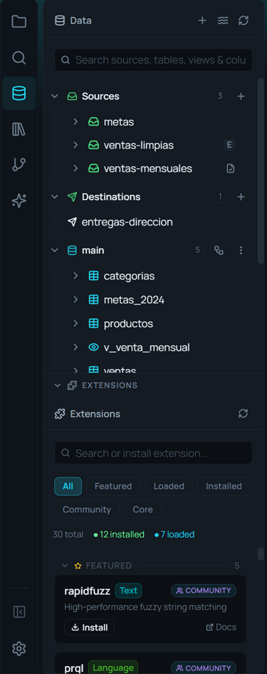

# Extensiones de DuckDB

**🌐 [English](../../en/data/duckdb-extensions.md) · Español**

> Amplía lo que DuckDB puede hacer: instala y carga extensiones para leer la nube, escribir Excel real, trabajar con datos geoespaciales y más — desde un panel, sin SQL.

## Qué es

El panel de Extensiones gestiona las extensiones de DuckDB: piezas opcionales que añaden funciones y formatos. Muestra las destacadas, las del núcleo (core), las de la comunidad, y cuáles tienes **instaladas** y **cargadas**.

Cada extensión tiene dos estados: **instalada** (descargada a tu máquina) y **cargada** (activa en la sesión actual). Instalar desde el panel hace ambas cosas; algunas extensiones del núcleo se cargan solas al usarlas.

Por debajo, el panel ejecuta `INSTALL` (con `FROM community` cuando corresponde) y `LOAD`, con reintento automático desde la comunidad y avisos si la extensión aún no está disponible para tu plataforma.

## Cuándo usarlo

- Para habilitar capacidades que otras features necesitan: `httpfs` (nube), `excel` (`.xlsx`), `spatial` (geo).
- Para explorar qué extensiones existen e instalar una por nombre.
- Para comprobar qué está cargado en la sesión actual.

## Cómo usarlo

### Buscar e instalar
1. Abre el panel de **Extensiones** en la barra lateral.
2. Escribe en el buscador para filtrar por nombre o descripción.
3. Si el nombre no existe aún en la lista, aparece un botón **Install** para instalarlo directamente.
4. En una tarjeta, pulsa **Install** (descarga + carga) o, si ya está instalada, **Load** para activarla.

### Filtrar
Los chips de filtro acotan la galería:
- **All** — todo · **Featured** — recomendadas · **Loaded** — activas ahora · **Installed** — descargadas · **Community** — de la comunidad · **Core** — del núcleo.

La barra de estado muestra el total, cuántas están instaladas y cuántas cargadas.

### Cargar y recargar
Una extensión instalada pero no cargada muestra **Load**. Con clic derecho sobre cualquier extensión tienes **Copiar nombre**, **Cargar/Recargar**, **Abrir documentación** y **Copiar comandos SQL** (`INSTALL` + `LOAD` listos para pegar).

### Tus propias extensiones
Al pie del panel, **Your own extensions** sirve para una extensión que compilaste tú o que recibiste como archivo, sin la firma de los repositorios oficial o community.

1. Marca **Allow unsigned extensions** (desde la 6.0.1). Una extensión sin firma ejecuta código que nadie ha verificado, con tus permisos, así que el panel pregunta antes. El motor sólo acepta este ajuste al arrancar, por eso confirmar lo reinicia: tu base sigue abierta y las vistas temporales (las celdas de los cuadernos) se borran.
2. **Install from file…** elige el `.duckdb_extension`, lo instala y lo carga. Su nombre es el del archivo hasta el primer punto (`mi_ext.duckdb_extension` es `mi_ext`). Desde entonces se carga al abrir AmoxSQL, como cualquier otra.

El ajuste se guarda en `~/.amoxsql/config.json` (`extensionesSinFirma`) y vale para todos los motores que abre AmoxSQL: también las ejecuciones de Data Flow, las programadas y la línea de comandos. Sin él, instalar un archivo sin firma lo dice así en vez de fallar con el mensaje del motor. Desde el editor SQL, `INSTALL '/ruta/mi_ext.duckdb_extension'; LOAD mi_ext;` hace lo mismo una vez encendido el ajuste.

## Referencia de opciones

### Filtros
| Filtro | Muestra |
|---|---|
| All | Todas las extensiones |
| Featured | Selección recomendada |
| Loaded | Cargadas en la sesión actual |
| Installed | Descargadas en la máquina |
| Community | Del repositorio de la comunidad |
| Core | Del núcleo de DuckDB |

### Extensiones clave
| Extensión | Para qué sirve |
|---|---|
| `httpfs` | Leer/escribir en la nube (S3, GCS) — necesaria para export a la nube |
| `excel` | Escribir `.xlsx` real con `COPY ... (FORMAT xlsx)` |
| `spatial` | Datos y funciones geoespaciales |

## Tips y gemas

- **Instalar = instalar + cargar:** el botón hace las dos cosas; no necesitas ejecutar `LOAD` a mano.
- **Reintento desde la comunidad:** si una extensión no está en el repo oficial, el panel reintenta automáticamente desde la comunidad.
- **Avisos de plataforma:** si una extensión aún no soporta tu sistema o versión de DuckDB, verás un aviso claro en lugar de un fallo críptico.
- **El núcleo se autocarga:** muchas extensiones core (como `json` o `parquet`) se cargan solas al usarlas; no hace falta gestionarlas.
- **Copia los comandos:** el menú contextual te da el `INSTALL`/`LOAD` exacto para reproducir la configuración en un script.

## Relacionado

- [Exportar datos](exporting-data.md) · [Importar datos](importing-data.md) · [Google Sheets](google-sheets.md)
- [Editor SQL](../editor/sql-editor.md) · [Configuración](../reference/configuration.md)
