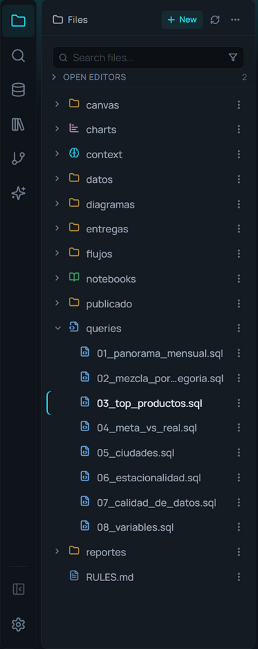

# Explorador de archivos

**🌐 [English](../../en/data/file-explorer.md) · Español**

> Los archivos de tu proyecto: ábrelos, encuéntralos en cualquier carpeta, crea, renombra y mueve, e importa datos a la base, todo desde la barra lateral, sin salir de AmoxSQL.

## Qué es

El explorador de archivos es el panel **Files** de la izquierda. Muestra tus scripts `.sql`, notebooks `.sqlnb`, gráficos `.amoxvis`, decks `.amoxdeck`, procesos `.sqlchain`, datos (CSV, Parquet, JSON, Excel) y cualquier otro archivo, con un icono de color por tipo.

Es tu punto de entrada a los datos: desde aquí abres archivos, los importas a la base de datos, los consultas directamente o copias sus nombres de columna. También gestiona el ciclo de vida de los archivos (crear, renombrar, mover, duplicar, borrar) sin tocar el explorador del sistema operativo.

Algunos archivos no se enseñan a propósito: las bases (`.duckdb`, `.db`, los lagos), que se conectan desde el panel **Data**; lo que AmoxSQL escribe para sí junto a tus archivos (el estado visual de un notebook, los temporales de una escritura), y los archivos y carpetas que empiezan por punto, salvo que actives **Show hidden files**.

## Cuándo usarlo

- Para abrir cualquier archivo del proyecto, o crear uno nuevo.
- Para encontrar un archivo sin saber en qué carpeta está.
- Para llevar un CSV/Parquet/JSON/Excel a la base como tabla (ver [Importar datos](importing-data.md)) o consultarlo en el sitio sin importarlo.
- Para reorganizar el proyecto: mover, renombrar, duplicar o borrar archivos en bloque.
- Para el esquema ya cargado en la base, usa el [Explorador de base de datos](database-explorer.md); este panel es para archivos en disco.

## Cómo usarlo

### Dos formas de ver el proyecto
En **Ajustes → Behavior → File Explorer → Explorer View** eliges:

- **Folders** (la de serie): una carpeta cada vez. Haz clic en una carpeta para entrar; el **breadcrumb** de arriba (o la flecha **Subir**) te devuelve.
- **Tree**: todo el proyecto como un árbol. Cada carpeta se despliega en su sitio con su flecha, y el proyecto recuerda cuáles dejaste abiertas. El menú **…** añade **Collapse all**. El archivo de la pestaña activa se **revela** solo: se abren las carpetas que lo contienen y su fila queda marcada con una barra del color de acento.

### Encontrar un archivo
Escribe en **Search files…**: se busca en **todo el proyecto**, no sólo en la carpeta en pantalla, y cada resultado lleva al lado la carpeta donde está. Si el texto lleva una barra, se compara con la ruta entera: `2024/cie` encuentra `informes/2024/cierre.sql` y no `informes/2023/cierre.sql`.

El **embudo** de la caja de búsqueda filtra por tipo (**Show only**): SQL, Notebooks, Charts, Data Flow, decks/canvases/diagramas, archivos de datos y Markdown/texto. Puedes marcar varios; el embudo dice cuántos hay activos y el filtro se recuerda. Con un tipo marcado y sin texto, ves todos los archivos de ese tipo del proyecto. **Show all types** lo quita.

### Lo que va arriba: Open Editors y Favorites
- **Open Editors** lista las pestañas abiertas (las de cada panel por separado si la pantalla está dividida), con la activa marcada y un punto en las que tienen cambios sin guardar. Un clic la activa; la **X** (al pasar el ratón) o el clic central la cierra. Viene plegada; despliégala con su título.
- **Favorites**: clic derecho en un archivo o carpeta → **Add to Favorites**. Cada proyecto tiene los suyos y siguen al archivo si lo renombras desde el explorador. Un favorito que es carpeta se despliega en el árbol (o se entra en ella en la vista de carpetas). La estrella de la fila lo quita. La sección sólo aparece cuando hay alguno.

### Los gráficos van con su consulta
Un gráfico guardado desde un `.sql` (**Save as chart…**) se ve **debajo de su consulta** cuando están en la misma carpeta: el `.sql` lleva una flecha que despliega sus gráficos. Si el gráfico está en otra carpeta, o no viene de un `.sql`, se ve suelto como cualquier archivo. Se puede apagar en **Ajustes → Behavior → File Explorer → Nest Related Files**.

### Abrir un archivo
Haz clic en el archivo. Lo que pasa depende del tipo:
- `.sql`, `.sqlnb`, `.md`, `.amoxdeck`, `.sqlchain`, `.amoxcanvas`, `.amoxdiagram` → se abren en su editor.
- `.amoxvis` → abre el gráfico en Story Flow.
- `.xlsx`/`.xls` → **siempre** abren como Consulta directa (Direct Query).
- `.csv`, `.parquet`, `.json` → siguen tu ajuste de acción por defecto (vista previa o consulta directa).

**Arrastra** un archivo del explorador al editor para abrirlo en el panel donde lo sueltas; si es un archivo de datos, se consulta, igual que al soltarlo desde el sistema. **Open to the Side** (en el menú contextual) lo abre en el otro panel, y divide la pantalla si hacía falta.

### Crear archivos y carpetas
**+ New** en la cabecera abre un menú con cada tipo de archivo y **New folder**; se crean en la carpeta actual. Sobre una carpeta, el menú contextual añade **Nuevo archivo aquí** y **Nueva carpeta aquí**.

### Ordenar
El menú **…** de la cabecera ordena la lista: por defecto (carpetas primero), por nombre, **por fecha de modificación** (lo más reciente primero), por categoría, por extensión y por tamaño. En modo categoría o extensión, la vista de carpetas agrupa los archivos con encabezados y contador. El orden de serie se elige en **Ajustes → Behavior → Default Explorer Sort View**. En el mismo menú está **Show hidden files**.

El nombre del archivo manda: un nombre largo se recorta **por el medio**, porque el final suele ser lo que lo distingue de otro. El tamaño y la fecha salen al pasar el ratón o al seleccionar.

### Operaciones de archivo
Clic derecho (o el botón de tres puntos) abre el menú contextual:
- **Open to the Side**, **Open as text**.
- **Cortar / Copiar / Pegar** (también `Ctrl+X` / `Ctrl+C` / `Ctrl+V`).
- **Duplicar**, **Mover a…** (selector de carpeta), **Renombrar** (`F2`).
- **Añadir a .gitignore**, **Eliminar** (borra en bloque si hay varios seleccionados).
- **Add to Favorites**, **Revelar en el Explorador** (abre la carpeta en tu sistema), **Copy Path** (la ruta completa en el disco), **Copiar ruta relativa**, **Copiar nombre**.

Puedes **arrastrar** un archivo sobre una carpeta para moverlo. Selecciona varios con `Ctrl+clic` o `Shift+clic` para operar en bloque.

### Acciones sobre archivos de datos
Para CSV/TSV/Parquet/JSON/Excel, el menú añade acciones de datos:
- **Importar a la base…**: crea una tabla (ver [Importar datos](importing-data.md)).
- **Vista rápida**: 100 filas en un modal (CSV/Parquet/JSON).
- **Consulta directa**: abre una pestaña SQL con el `SELECT * FROM '<ruta>'` (o `read_xlsx(...)` para Excel) más comentarios con las columnas; para CSV/Parquet/JSON se ejecuta al instante.
- **Copiar nombres de columna**: al portapapeles como comentario SQL (para Excel, por hoja).
- **Metadata para IA…**: genera contexto del archivo (ver [Metadata para IA](../ai/metadata-for-ai.md)).

Sobre un `.sql`, el menú ofrece **Exportar resultados…**, que lee la query del archivo y abre el diálogo de export (ver [Guardar resultados](../results/saving-results.md)), y **Charts using this query…**.

## Referencia de opciones

### Cabecera, búsqueda y menú contextual
| Acción | Qué hace |
|---|---|
| + New | Crea un archivo del tipo elegido, o una carpeta, en la carpeta actual |
| … | Orden · Show hidden files · Collapse all (en árbol) |
| Search files… | Busca por nombre (o por ruta, con una barra) en todo el proyecto |
| Embudo (Show only) | Sólo los tipos marcados, en todo el proyecto |
| Open to the Side | Abre el archivo en el otro panel |
| Cortar / Copiar / Pegar | Mueve o copia archivos (`Ctrl+X/C/V`) |
| Duplicar · Mover a… · Renombrar | Copia con sufijo · elige carpeta destino · `F2` |
| Añadir a .gitignore | Añade el patrón del archivo/carpeta al `.gitignore` |
| Add to / Remove from Favorites | Lo pone arriba, en Favorites |
| Revelar en el Explorador | Abre la ubicación en tu sistema operativo |
| Copy Path · Copiar ruta relativa · Copiar nombre | La ruta completa · la ruta dentro del proyecto (con `/`) · sólo el nombre |
| Eliminar | Borra el archivo o toda la selección (con confirmación) |

### Ajustes (Behavior → File Explorer)
| Ajuste | De serie | Qué hace |
|---|---|---|
| Nest Related Files | Activado | Los gráficos de un `.sql`, debajo de él |
| Explorer View | Folders | Folders (una carpeta cada vez) o Tree (todo el proyecto) |
| Show File Sizes in Explorer | Activado | El tamaño junto al nombre al pasar el ratón |
| Default Explorer Sort View | Default | El orden con el que se abre |

### Badges de estado git
| Badge | Significado |
|---|---|
| M | Modificado |
| A | Añadido |
| D | Borrado |
| ? | Sin seguimiento |
| Punto en una carpeta | Hay cambios dentro |

## Tips y gemas

- **Encuentra por la carpeta:** escribe `informes/` y verás todo lo que hay bajo cualquier carpeta `informes`.
- **Excel siempre es Consulta directa:** al abrir un `.xlsx` no se importa; se genera una query `read_xlsx(...)` para que decidas.
- **Favorites para lo de todos los días:** el `.sql` del cierre mensual, la carpeta de entregas; a un clic, sin bajar por el árbol.
- **Copiar nombres de columna entiende hojas:** en un Excel copia las columnas de cada hoja etiquetadas por su nombre.
- **La sección de Google Sheets** vive al final del panel; conecta hojas por URL (ver [Google Sheets](google-sheets.md)).

## Atajos y formatos relacionados

| Atajo | Acción |
|---|---|
| Ctrl+Shift+E | Mostrar el explorador de archivos |
| F2 | Renombrar el archivo seleccionado |
| Delete | Eliminar la selección |
| Ctrl+C · Ctrl+X · Ctrl+V | Copiar · Cortar · Pegar |
| Ctrl+clic · Shift+clic | Selección múltiple (individual · rango) |

## Relacionado

- [Layout, pestañas y paneles](../editor/layout-tabs-and-panes.md) · [Explorador de base de datos](database-explorer.md) · [Importar datos](importing-data.md)
- [Google Sheets](google-sheets.md) · [Guardar resultados](../results/saving-results.md) · [Metadata para IA](../ai/metadata-for-ai.md)
- [Formatos de archivo](../reference/file-formats.md) · [Configuración](../reference/configuration.md)
