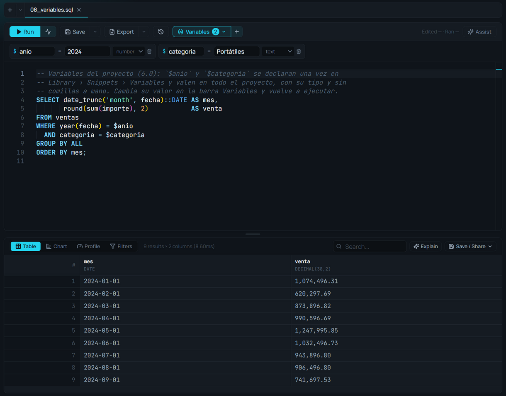

# Variables

**🌐 [English](../../en/editor/variables.md) · Español**

> Declara un valor una vez —la región, el año, el umbral— y úsalo en cualquier consulta del proyecto como `$nombre`, con su tipo y sin comillas a mano. Desde la 6.0.

## Qué es

Una **variable del proyecto** tiene nombre, tipo, valor y, si quieres, una descripción de para qué sirve. Se escribe `$nombre` dentro del SQL y el motor la lee **con su tipo**: un número es un número, una fecha es una fecha. Por eso no hace falta entrecomillarla y ningún valor puede cambiar la consulta (un texto como `'; DROP TABLE ventas; --` es sólo un texto).

Las variables son **del proyecto**, no de una pestaña: se guardan en `.amoxsql/variables.json`, viajan con la carpeta (Git, un `.amoxproject`) y valen en todo lo que corre dentro de él: el editor, las celdas de un cuaderno, las tarjetas del Canvas, los gráficos guardados y los procesos de Data Flow, también cuando corren programados.

## Cuándo usarlo

- Cuando el mismo valor aparece en varias consultas: el año del cierre, la región del informe, el umbral de una alerta.
- Para guardar un gráfico, una celda o un proceso que **sigan funcionando**: llevan `$region`, no el valor.
- Para que otra persona del proyecto cambie el valor sin tocar el SQL.

## Cómo usarlo

### Declararlas
En **Library › Snippets › Variables**, **New variable**:

1. **Nombre**: letras, números y `_`, sin empezar por un número.
2. **Tipo**: *Text*, *Number*, *Date*, *Yes / no* o *List*.
3. **Valor**. Una lista se escribe separada por comas: `norte, sur, este`.
4. **Descripción** (opcional): qué es. La ven el editor al pasar el ratón y el Assistant.

Un clic en una variable de la lista inserta `$nombre` en el editor. El lápiz la edita y la papelera la quita.

### Usarlas en SQL

```sql
SELECT region, sum(importe) AS venta
FROM ventas
WHERE year(fecha) = $anio
  AND region = $region
  AND importe > $umbral
GROUP BY region;
```

Una lista y un sí/no:

```sql
SELECT *
FROM ventas
WHERE list_contains($regiones, region)
  AND $solo_activos;
```

Al escribir `$` el editor ofrece las variables con su tipo y su descripción, y al pasar el ratón sobre `$region` se ve su valor.

### La barra Variables del editor
El botón **Variables** de la barra de acciones (con el número de variables) despliega la misma lista bajo la barra, para cambiar un valor sin salir de la consulta: cambias `$anio` y vuelves a ejecutar. El **+** de al lado añade una. Las de tipo lista o sí/no se editan en Library.



### Si una variable no existe
El error lo dice en palabras: «$region is not a project variable. Declare it in Library › Snippets › Variables». Si alguien te pasa una consulta con `$algo`, declárala y vuelve a ejecutar.

## `$nombre`, `${nombre}` y `{{nombre}}`

| Escritura | Qué hace | Para qué |
|---|---|---|
| `$nombre` | El motor lee la variable del proyecto **con su tipo** | Valores: fechas, números, textos, listas |
| `${nombre}` | Pega el **texto** de la variable en el SQL antes de correrlo | Plantillas: un nombre de tabla, un trozo de SQL |
| `{{nombre}}` | Parámetro de un **cuaderno** o de un **deck**, propio de ese archivo | Textos y valores de un informe (ver [Notebooks](../notebooks/notebooks.md)) |

Para un valor, usa `$nombre`. `${nombre}` sigue funcionando como antes, pero pega el texto tal cual: un texto necesita sus comillas (`'${region}'`) y nada lo protege.

## Tips y gemas

- **Lo guardado sigue funcionando:** un `.amoxvis`, una celda o un proceso con `$anio` se recalcula con el valor que tenga ahora el proyecto.
- **`LIMIT $n` funciona**, igual que en cualquier otra parte de la consulta.
- **El Assistant las conoce:** sabe sus nombres, tipos, valores y descripciones, y las usa al escribir SQL.
- **En Data Flow**, los parámetros con tipo de un proceso también se leen como `$x` (ver [Línea de comandos y parámetros](../data-flow/command-line.md)).

## Relacionado

- [Editor SQL](sql-editor.md) · [Snippets](snippets.md) · [Autocompletado](autocomplete.md)
- [Notebooks](../notebooks/notebooks.md) · [Novedades de la 6.0](../user-guide/whats-new-6.md)
