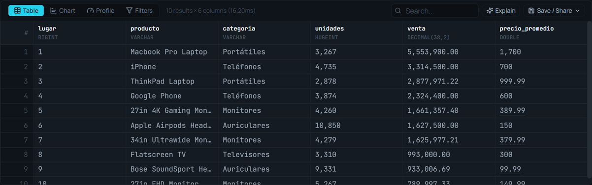
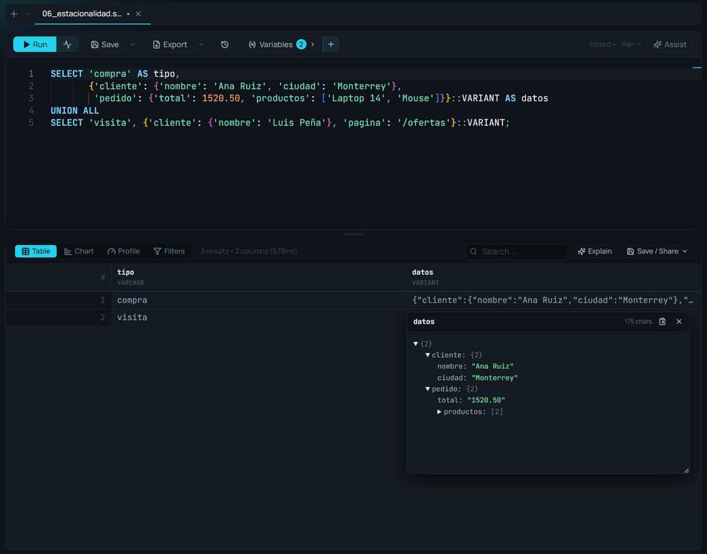

# Tabla de resultados

**🌐 [English](../../en/results/results-table.md) · Español**

> El panel donde aterrizan tus resultados: tabla explorable, gráfico o perfil, con búsqueda, filtros, orden y formato inteligente.

## Qué es

Cuando ejecutas una query —en el [Editor SQL](../editor/sql-editor.md) o en una celda de [notebook](../notebooks/notebooks.md)— los resultados aparecen en este panel. Tiene tres modos de vista:

- **Table** — una cuadrícula paginada con búsqueda, filtros, orden y redimensionado de columnas.
- **Chart** — el constructor de gráficos [Story Flow](../visualization/story-flow.md).
- **Profile** — el [perfil de datos](data-profiler.md), un análisis exploratorio automático.

Esta página cubre el **modo Tabla**. El conmutador de vista está arriba a la izquierda del panel; junto a él, un contador muestra cuántas filas hay y en cuántos milisegundos se ejecutó la consulta.

## Cuándo usarlo

- Para inspeccionar filas concretas, buscar valores o comprobar tipos de columna.
- Como punto de partida antes de graficar (Chart) o de diagnosticar la calidad de los datos (Profile).
- Cuando necesitas copiar o descargar rápidamente las filas que estás viendo (ver [Guardar resultados](saving-results.md)).

## Cómo usarlo

### Buscar y filtrar
1. **Búsqueda global:** escribe en el cuadro **Search** (arriba a la derecha) para filtrar filas en todas las columnas a la vez.
2. **Filtros por columna:** pulsa **Filters** para mostrar una fila de filtros bajo los encabezados; escribe en cada uno para filtrar esa columna. El contador indica "Filtrado desde N" cuando hay filtros activos.

### Ordenar
Haz clic en el encabezado de una columna para ordenar ascendente; vuelve a hacer clic para descendente. Los valores nulos se colocan al final. También puedes ordenar desde el menú contextual de la columna.

### Redimensionar columnas
Arrastra el borde derecho del encabezado de una columna para ajustar su ancho (mínimo 50 px). Los anchos se conservan mientras exploras.

### Menú contextual de columna
Haz **clic derecho** sobre el encabezado de una columna para:

- **Copy Column Name** — copia el nombre de esa columna.
- **Copy All Column Names** — copia todos los nombres, separados por comas.
- **Sort Ascending / Sort Descending** — ordena por esa columna.

### Valores anidados
Un valor con estructura —un VARIANT, un STRUCT, una lista, un MAP o un JSON— se ve en una línea; **un clic lo abre como árbol**, con cada clave y su tipo, plegable por niveles.

### Paginar
En la parte inferior, navega entre páginas con **‹ ›** y elige cuántas filas mostrar por página: **50 / 100 / 500 / 1000**.

### Sacar a una ventana aparte
**Save / Share › Pop out** envía los resultados a una ventana independiente, útil para verlos en un segundo monitor mientras sigues editando. La ventana es de esa pestaña: ejecutar en otra no la cambia. Ver [Pestañas y paneles](../editor/layout-tabs-and-panes.md).

## Referencia de formato de valores

La tabla formatea cada valor según su tipo para que se lea mejor; pasa el cursor por una celda para ver el valor completo.

| Tipo de valor | Cómo se muestra |
|---|---|
| Entero | Con separadores de miles (localizado) |
| Decimal | Hasta 4 decimales; el valor exacto en el tooltip |
| Fecha ISO (`...T00:00:00Z`) | Solo la parte de fecha (`AAAA-MM-DD`) |
| Fecha y hora ISO | Fecha y hora con espacio, sin la `Z` |
| `NULL` | Insignia atenuada **NULL** |
| Objeto / JSON | Serializado con `JSON.stringify` |

## Referencia de la barra de herramientas

| Control | Qué hace |
|---|---|
| **Table / Chart / Profile** | Cambia el modo de vista |
| **Filters** | Muestra/oculta la fila de filtros por columna (solo en Table) |
| **Search** | Búsqueda global sobre todas las columnas |
| **Explain** | Pregunta a Assist qué destaca en este resultado |
| **Save / Share ▾** | Un solo menú (desde la 6.0): **Save as table or view…** (ver [Guardar resultados](saving-results.md)), **Save to Analysis Vault…** (ver [Baúl de análisis](../ai/analysis-vault.md)), **Store for comparison** y **Compare with the other pane** (ver [Comparar resultados](compare-results.md)), **Pop out** (una ventana aparte) y la descarga de las filas mostradas (CSV, JSON, portapapeles) |
| **Compare** | Aparece mientras hay un resultado guardado para comparar |

## Tips y gemas

- **Aviso de truncado:** si tu query devuelve más filas que el límite de "Max Rows" (Ajustes → Editor), verás un aviso, "primeras N filas". Con Max Rows en 0 sigue habiendo un tope de seguridad de 1.000.000 de filas o 256 MB. Para el conjunto completo, usa **Export** en el editor o añade tu propio `LIMIT` (ver [Guardar resultados](saving-results.md)).
- **Buscar no re-ejecuta:** la búsqueda, los filtros y el orden operan **en memoria** sobre las filas ya cargadas —son instantáneos y no vuelven a consultar el motor—.
- **Descargar ≠ Exportar:** **Save / Share › Download** baja solo las filas cargadas en la tabla (ya filtradas y ordenadas); el **Export** del editor re-ejecuta la query completa. La distinción se explica en [Guardar resultados](saving-results.md).

## Relacionado

- [Comparar resultados](compare-results.md) · [Guardar resultados](saving-results.md)
- [Perfil de datos](data-profiler.md) · [Plan de ejecución](execution-plan.md)
- [Story Flow](../visualization/story-flow.md) · [Editor SQL](../editor/sql-editor.md)
