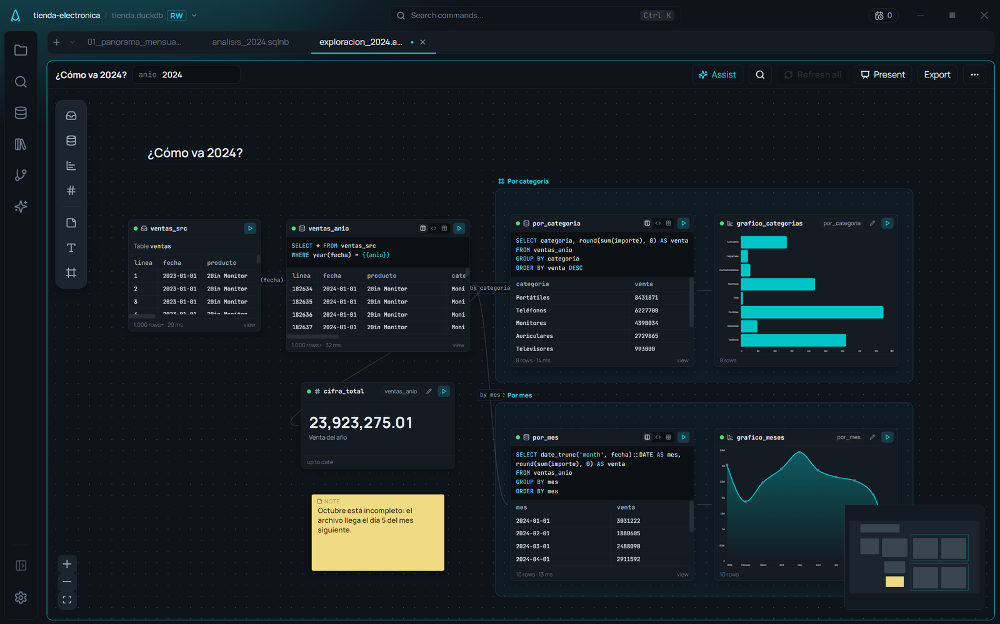
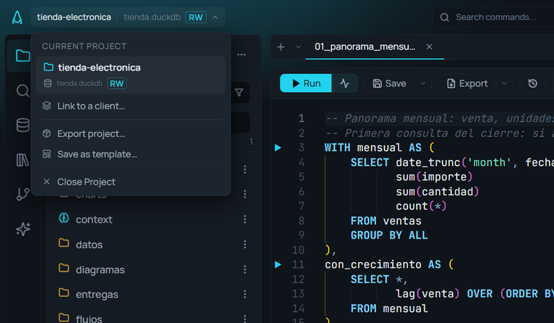
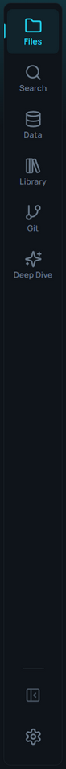
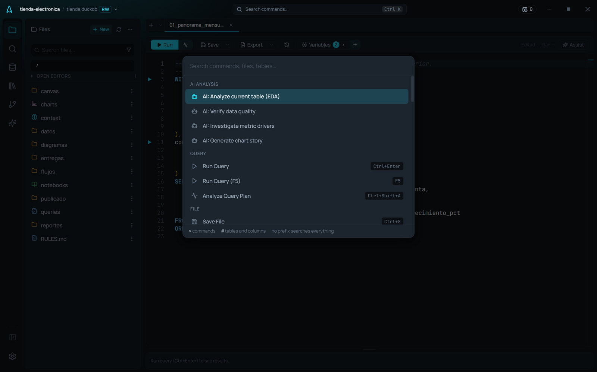

# La interfaz

**🌐 [English](../../en/user-guide/interface.md) · Español**

> Un recorrido por las zonas de AmoxSQL: la barra de actividad, el panel lateral, el área de editor con pestañas y paneles divididos, y la paleta de comandos.

## Zonas principales

### Barra de título (arriba)
Muestra el **proyecto activo** (nombre · modo de conexión MEM/RO/RW · base) y controles de ventana. El widget del proyecto despliega los proyectos recientes y la opción de cerrarlo.

### Barra de actividad (extremo izquierdo)
Siete entradas que cambian el contenido del panel lateral (desde la 6.0; antes eran quince iconos sueltos):

| Entrada | Qué hay dentro |
|---|---|
| **Files** | El [explorador de archivos](../data/file-explorer.md) del proyecto. **+ New** crea cualquier tipo de archivo o una carpeta; **…** ordena la lista |
| **Search** | Buscar en todo el proyecto |
| **Data** | El [explorador de base de datos](../data/database-explorer.md): fuentes, destinos, esquemas y tablas. Abajo, plegadas, las [extensiones de DuckDB](../data/duckdb-extensions.md) |
| **Library** | Cuatro pestañas: **Snippets** ([fragmentos SQL](../editor/snippets.md) y variables del proyecto), **Functions** (referencia de funciones), **History** ([historial](../editor/history-and-bookmarks.md)) y **Saved** ([análisis guardados](../ai/analysis-vault.md)). Se abre en la última que usaste |
| **dbt** | [DBT Studio](../dbt/dbt-studio.md). Sólo aparece si la carpeta tiene `dbt_project.yml` |
| **Git** | Estado de Git del proyecto. Sólo aparece si la carpeta es un repositorio |
| **Deep Dive** | [Análisis agéntico profundo](../ai/deep-dive.md) |

Abajo: plegar el panel lateral (**Ctrl+B**) y **Ajustes**. La **galería de gráficos** y **New Data Flow** ya no están en la barra: son acciones, y siguen en el «+» de las pestañas, en la pantalla de un archivo nuevo y en la paleta (**Ctrl+K**). Desde la paleta también se llega directo a cada panel (por ejemplo «Show Query History», o «Show DBT Studio» aunque la carpeta todavía no sea de dbt).

Si prefieres ver el nombre bajo cada icono: **Ajustes → Appearance → Activity Bar → Show names under the icons**. Los atajos no cambiaron (**Ctrl+Shift+E** archivos, **Ctrl+Shift+F** buscar, **Ctrl+Shift+D** datos).

### Área de editor (centro)
Aquí viven las **pestañas**. Cada pestaña es un archivo (`.sql`, `.sqlnb`, `.sqlchain`, `.md`, `.amoxdeck`, `.amoxvis`) o una vista especial (Deep Dive, diagrama ER, linaje DBT). Puedes:

- **Dividir en dos paneles** y arrastrar pestañas entre ellos (ver [Layout, pestañas y paneles](../editor/layout-tabs-and-panes.md)).
- Editar SQL con resultados debajo (ver [Editor SQL](../editor/sql-editor.md)).

<!-- 📷 CAPTURE: docs/images/user-guide/split-view.png — vista dividida en dos paneles -->

### Panel de resultados (debajo del editor)
Aparece al ejecutar una query. Alterna entre **Table**, **Chart** y **Profile**. Ver [Tabla de resultados](../results/results-table.md).

## Paleta de comandos

**Ctrl+Shift+P** abre la paleta: busca y ejecuta cualquier acción (correr query, guardar, cambiar tema, abrir paneles, zoom, tours…). Es la forma más rápida de llegar a cualquier función sin recordar dónde está. Ver [Paleta de comandos](../editor/command-palette.md).

## Apariencia

El tema (claro/oscuro; desde la 6.0 una instalación nueva empieza en **Amox Dark**), el color de acento, la tipografía y el zoom se ajustan en **Ajustes → Appearance**. Ver [Temas y apariencia](themes-and-appearance.md).

## Relacionado
- [Primeros pasos](first-steps.md) · [Proyectos y conexiones](projects-and-connections.md)
- [Layout, pestañas y paneles](../editor/layout-tabs-and-panes.md) · [Paleta de comandos](../editor/command-palette.md)
- [Atajos de teclado](../reference/keyboard-shortcuts.md)
