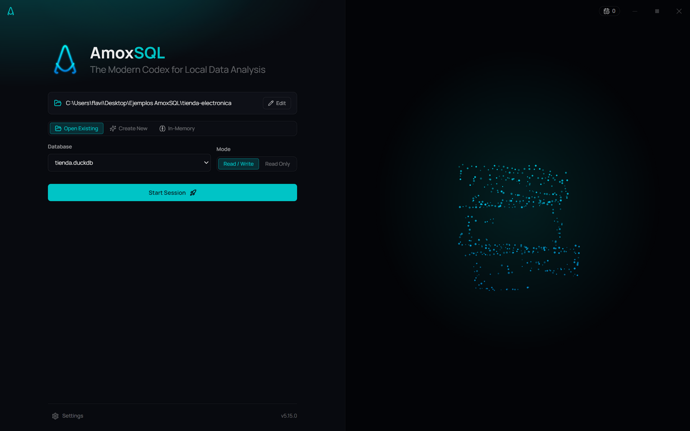

# Proyectos y conexiones

**🌐 [English](../../en/user-guide/projects-and-connections.md) · Español**

> AmoxSQL organiza tu trabajo por **proyectos** (carpetas) y se conecta a bases DuckDB en tres modos. Aquí verás cómo abrir, cambiar y conectar.

## Proyectos (carpetas de trabajo)

Un **proyecto** es simplemente una carpeta en tu disco. Todo lo que creas —queries `.sql`, notebooks, gráficos `.amoxvis`, decks, chains, contexto de IA— vive dentro de esa carpeta. Al abrir un proyecto, el [explorador de archivos](../data/file-explorer.md) muestra su contenido.

- **Abrir:** en la pantalla de bienvenida, ingresa la ruta absoluta; o usa un **reciente**.
- **Cambiar de proyecto:** desde el widget del proyecto en la barra de título.
- **Cerrar proyecto** (*Close Project*): vuelve a la pantalla de bienvenida.

AmoxSQL reconoce carpetas canónicas por su nombre (queries, notebooks, charts, chains, data, exports, context, agent) y les pone iconos especiales, pero no te obliga a usarlas.

## Conexiones a base de datos

DuckDB puede trabajar de dos maneras: **en memoria** (efímero) o **adjuntando** un archivo de base de datos (`.duckdb`/`.db`).

### Modos de conexión

| Modo | Qué significa |
|---|---|
| **In-Memory** | No hay archivo de base. Las tablas viven en RAM durante la sesión. Perfecto para explorar archivos (CSV/Parquet/Excel) con `SELECT * FROM 'archivo'`. |
| **Read-Only** | Adjunta una base existente sin poder modificarla. Seguro para inspeccionar producción. |
| **Read/Write** | Adjunta una base y persiste cambios (crear tablas, insertar, etc.). |

Al abrir un proyecto con archivos `.db`, un modal te deja elegir cuál adjuntar y en qué modo. Si no hay ninguno, arrancas en memoria.

### Cambiar de base
Puedes conectar, desconectar o cambiar de base durante la sesión. AmoxSQL usa una estrategia de **"hard reset"** para cambios limpios: al desconectar, vuelve a un estado en memoria fresco, evitando estados corruptos entre proyectos (importante en Windows por los locks de archivo).

Aun con una base adjunta, siempre puedes consultar archivos sueltos del disco directamente — DuckDB los lee sin importarlos.

## Consultar archivos vs importar
- **Consultar directo:** `SELECT * FROM 'data/x.parquet'` — sin importar, ideal para exploración.
- **Importar:** carga el archivo como una tabla en la base (persistente en modo R/W). Ver [Importar datos](../data/importing-data.md).

## Donde lo dejaste

Al volver a abrir un proyecto, si pasó algo desde la última vez, una tarjeta encima del editor lo cuenta antes de nada:

- su **estado** y su **fecha de entrega**;
- lo que **falló o avisó sin nadie delante** (programado, desde la línea de órdenes, un lote), con la razón;
- la **última ejecución** de cada proceso y cuántas corrieron desde la última vez;
- en un repositorio, los **commits nuevos** (y de quién) y los archivos sin guardar;
- las **fuentes** que aquí no se leen o llegan viejas.

Tus pestañas vuelven las de **este** proyecto. **Continue** cierra la tarjeta; **Open <proceso>** abre el último que corrió.

## Llevar un proyecto en un archivo (`.amoxproject`)

Cuando git no es opción —pasarle el proyecto a alguien, o empezar el siguiente cliente igual que éste—, en el menú del proyecto de la barra de título:

- **Export project…**: un archivo con los procesos, las consultas, los cuadernos, los gráficos, los decks, el contexto del asistente, las fuentes y los destinos. **Los datos se eligen** y van desmarcados, salvo la plantilla de Excel que llena un nodo Excel. Nunca viajan las credenciales (sólo sus nombres), `.git`, `.env`, la carpeta de trabajo ni las entregas anteriores.
- **Save as template…**: lo mismo sin datos, para empezar el siguiente desde ahí.

En la vista de workspaces, **From a package…** crea un proyecto nuevo desde un paquete: eliges la carpeta y el nombre, se extrae con un id propio y te dice **lo que le falta en esta máquina** (la credencial por su nombre, la extensión, la fuente sin su archivo).

## Relacionado
- [Primeros pasos](first-steps.md) · [Explorador de archivos](../data/file-explorer.md)
- [Explorador de base de datos](../data/database-explorer.md) · [Importar datos](../data/importing-data.md)
- [Arquitectura](../concepts/architecture.md)
- [Workspaces: agrupar proyectos](workspaces.md)
