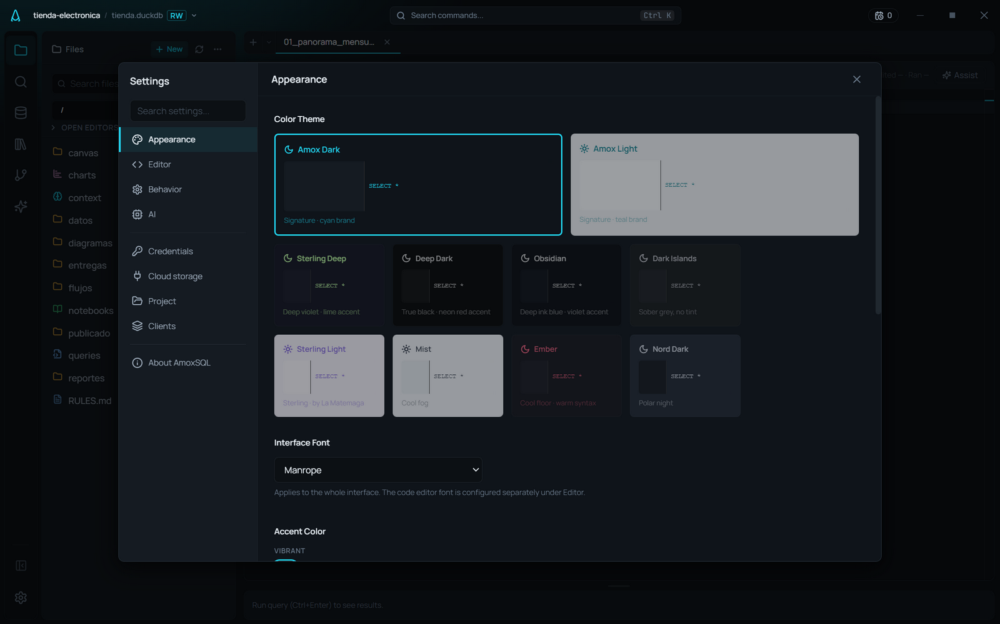
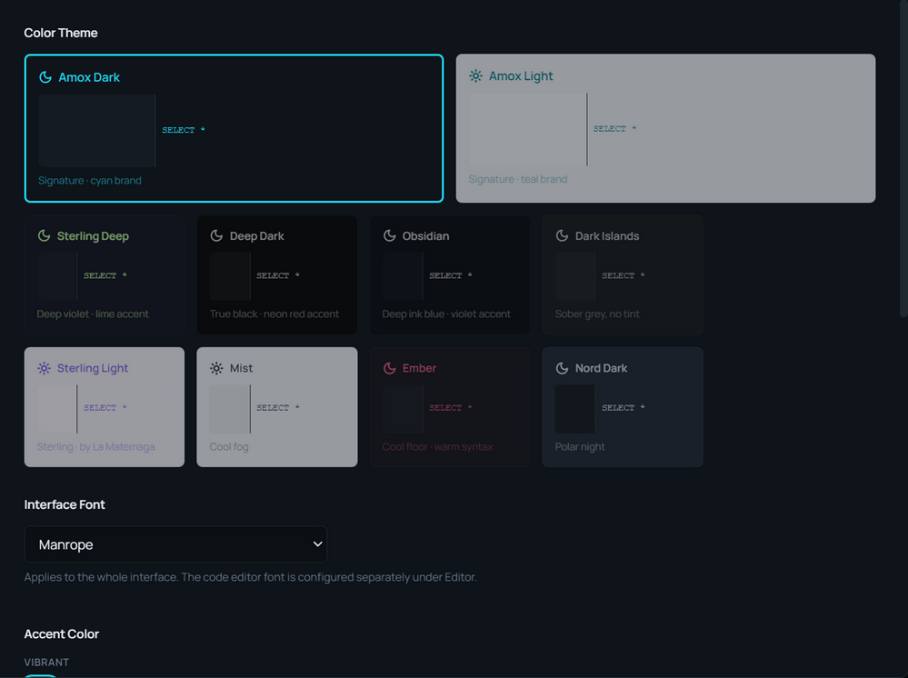

# Temas y apariencia

**🌐 [English](../../en/user-guide/themes-and-appearance.md) · Español**

> AmoxSQL trae 10 temas (claros y oscuros), cada uno con su acento, y 16 acentos más para elegir, con el editor de código y los gráficos siguiendo tu elección en vivo.

## Dónde se ajusta
**Ajustes → Appearance** (icono de engranaje en la barra de actividad, o Ctrl+,).

## Temas (10)

Una instalación nueva empieza en **Amox Dark** (desde la 6.0); si ya habías elegido otro tema, se queda el tuyo.

| Tema | Modo | Cómo es | Su acento |
|---|---|---|---|
| **Amox Dark** | Oscuro | El de la casa: carbón frío | Cian de la marca |
| **Amox Light** | Claro | El claro de la casa | Teal de la marca |
| **Sterling Deep** | Oscuro | Gris violeta | Lima |
| **Sterling Light** | Claro | Papel lavanda, tinta violeta | Violeta |
| **Obsidian** | Oscuro | Negro azulado, el más hondo con tinte | Violeta |
| **Deep Dark** | Oscuro | Negro sin tinte: el dato es lo único con color | Rojo neón |
| **Ember** | Oscuro | Suelo neutro, código cálido | Coral |
| **Dark Islands** | Oscuro | Gris sobrio | Azul |
| **Nord Dark** | Oscuro | Noche polar, todo apagado | Azul escarcha |
| **Mist** | Claro | Niebla fría, poco brillo | Índigo |

Todos están calibrados a los mismos pisos de contraste (accesibilidad WCAG), así que el texto es legible en cualquiera. Amox Dark y Amox Light son los temas de marca.

## Colores de acento
El acento tiñe botones, resaltados, enlaces y elementos activos.

- **Theme** (la primera muestra): el acento que trae el tema, el de la tabla de arriba. Es el de serie, y cambia contigo cuando cambias de tema.
- **10 vibrantes:** Cyan, Blue, Violet, Magenta, Pink, Neon red, Orange, Yellow, Lime, Green.
- **6 sobrios:** Sage, Sand, Clay, Mauve, Steel, Graphite (un acento sin color).

Cada acento tiene su versión para tema claro, más oscura, para que se lea como texto y como botón. Con **Neon red** en un tema oscuro, los errores pasan a bermellón, para que un botón principal no se confunda con uno de borrar.

Si tenías elegido un acento que ya no está, se cambia solo por el más parecido: Rose por Clay, Lavender por Mauve, Amber y Copper por Sand.

## El editor y los gráficos siguen tu tema
- El **editor de código** adopta el tema y el acento activos en vivo — sin recargar.
- Los **gráficos** generados por la IA tienen en cuenta el tema activo (fondo claro/oscuro y acento) para elegir paletas que se lean bien sobre tu lienzo (ver [Precisión y guardrails de la IA](../ai/accuracy-and-guardrails.md)).

## Otros ajustes de apariencia
| Ajuste | Qué hace |
|---|---|
| **Layout del editor** | Horizontal (default) o Vertical (para monitores ultrawide) |
| **Tipografía de la interfaz** | Fuente de la UI |
| **Zoom de UI** | Escala general de la interfaz (Ctrl += / Ctrl +- / Ctrl +0) |

Las opciones específicas del editor de código (fuente del código, minimapa, word wrap, etc.) están en **Ajustes → Editor**, ver [Editor SQL](../editor/sql-editor.md) y [Configuración](../reference/configuration.md).

## Relacionado
- [La interfaz](interface.md) · [Configuración](../reference/configuration.md)
- [Editor SQL](../editor/sql-editor.md)
