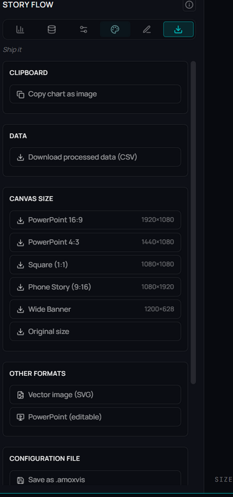

# Exportar gráficos

**🌐 [English](../../en/visualization/exporting-charts.md) · Español**

> La etapa Export de Story Flow: saca el gráfico como PNG en tamaños listos para slides o redes, cópialo al portapapeles, o guárdalo como `.amoxvis` para reutilizarlo y refrescarlo.

## Qué es

La etapa **Export** ("Ship it") es el paso ⑥ de [Story Flow](story-flow.md). Tiene dos naturalezas distintas: sacar una **imagen** (PNG a un tamaño concreto o al portapapeles) y guardar la **configuración** como archivo `.amoxvis`. La imagen es el resultado final; el `.amoxvis` es la receta reutilizable — recuerda que **lleva la query dentro**, así que el gráfico puede regenerarse solo o dentro de un deck de [Report Flow](../reports/report-flow.md).

## Cuándo usarlo

- **PNG** cuando necesitas una imagen para pegar en una presentación, documento o red social.
- **Copiar al portapapeles** cuando vas a pegar de inmediato en otra app.
- **`.amoxvis`** cuando el gráfico vive más de un momento: lo reabrirás, lo pondrás en un deck o lo refrescarás con datos nuevos.
- **Pegar JSON de la IA** cuando un asistente te entrega un gráfico en Vega-Lite (o una configuración de Story Flow) y quieres aplicarlo al resultado actual.

## Cómo usarlo

### Descargar como PNG
1. Abre la pestaña **Export**.
2. En **Canvas size**, elige un preset o **Original size** (usa el tamaño real en pantalla).
3. El PNG se genera y se descarga al instante. En pantalla completa, un botón **PNG** hace lo mismo con el tamaño actual.

### Copiar al portapapeles
1. En **Clipboard**, pulsa **Copy chart as image**.
2. El gráfico se copia como PNG; pégalo con Ctrl+V en cualquier app.

### Guardar y cargar configuración
1. En **Configuration file**, pulsa **Save as .amoxvis** y dale nombre.
2. Se guarda la configuración completa **más la query** que alimenta el gráfico.
3. Para recuperar una configuración, usa **Load configuration** y elige un `.amoxvis` (o `.json`).

### Llevarlo a otra herramienta
Un gráfico de AmoxSQL es Vega-Lite, así que puede salir de AmoxSQL y seguir siendo el mismo gráfico. En **Export → Take it elsewhere**:

| Opción | Qué descarga | Para qué |
|---|---|---|
| **Vega-Lite with data** | `<título>.vl.json` con los datos dentro (`data.values`) y la consulta en `description` | Abrir el gráfico en cualquier editor o visor de Vega-Lite, tal cual |
| **Template (data as "dataset")** | `<título>.template.vl.json` con los datos por nombre (`"data": {"name": "dataset"}`) | Visuales que reciben los datos de otro sitio, como Deneb en Power BI: pegas el spec y le das tus datos |
| **Python script** | `<título>.py`: la consulta en DuckDB y la figura con Altair | Rehacer el gráfico desde Python, con los datos al día |

- **Keep AmoxSQL's look** (activado por defecto) lleva el aspecto de AmoxSQL como `config` de Vega-Lite —tipografía, ejes, rejilla, paleta— con los colores pensados para un fondo claro. Desactívalo para un Vega-Lite con el aspecto por defecto.
- El formato de número propio de AmoxSQL se traduce a un formato estándar de Vega-Lite al exportar.
- El mapa de rectángulos se guarda como spec de **Vega** (no Vega-Lite), así que no tiene script de Python.

### Pegar JSON desde la IA
1. Pulsa **Paste JSON from AI** y pega un spec de **Vega-Lite** (lo que escribe la *AmoxSQL Data & Viz Skill* y casi cualquier asistente) o una configuración de Story Flow.
2. Los datos son siempre el resultado actual: si el spec trae sus propios datos, se cambian por `"data": {"name": "dataset"}`.
3. AmoxSQL **comprueba las columnas** que nombra el spec. Si alguna no está en el resultado, o si cambió los datos, te lo dice antes: **Apply anyway** lo aplica igual.
4. El gráfico se dibuja con el spec; los paneles toman lo que entienden y el resto queda como código propio (ver [Story Flow](story-flow.md#el-código-manda)).

## Referencia de opciones

### Presets de tamaño (PNG)
| Preset | Dimensiones | Para |
|---|---|---|
| PowerPoint 16:9 | 1920 × 1080 | Slide panorámica |
| PowerPoint 4:3 | 1440 × 1080 | Slide clásica |
| Square (1:1) | 1080 × 1080 | Publicación cuadrada |
| Phone Story (9:16) | 1080 × 1920 | Historia vertical |
| Wide Banner | 1200 × 628 | Banner / vista previa de enlace |
| Original size | tamaño en pantalla | Exportar tal cual se ve |

### Acciones
| Acción | Qué hace |
|---|---|
| Copy chart as image | Copia el gráfico al portapapeles como PNG |
| Save as .amoxvis | Guarda configuración + query en un archivo `.amoxvis` |
| Load configuration | Carga un `.amoxvis`/`.json` en el gráfico actual |
| Paste JSON from AI | Aplica un Vega-Lite o una config pegada, comprobando las columnas |

## Tips y gemas

- **El `.amoxvis` no es una imagen:** es la receta viva con la query; ábrelo más tarde y se re-ejecuta con datos actuales.
- **Original size respeta tu layout:** si ajustaste márgenes y proporción, "Original size" exporta exactamente eso.
- **La comprobación evita ejes rotos:** si lo pegado apunta a columnas que no están en el resultado, lo verás antes de aplicarlo.
- **PNG para compartir, `.amoxvis` para construir:** usa PNG cuando el destino es plano; usa `.amoxvis` cuando el gráfico entrará en un deck de Report Flow.
- **El `.amoxvis` ya es Vega-Lite:** «Take it elsewhere» añade los datos o el script, pero el archivo guardado también se abre fuera de AmoxSQL.

## Formatos relacionados

- `.amoxvis` — configuración de gráfico con query embebida (ver [Formatos de archivo](../reference/file-formats.md)).

## Relacionado

- [Story Flow](story-flow.md) · [Formato y estilo](format-and-style.md)
- [Report Flow (decks)](../reports/report-flow.md) · [Exportar a Office](../reports/export-to-office.md)
