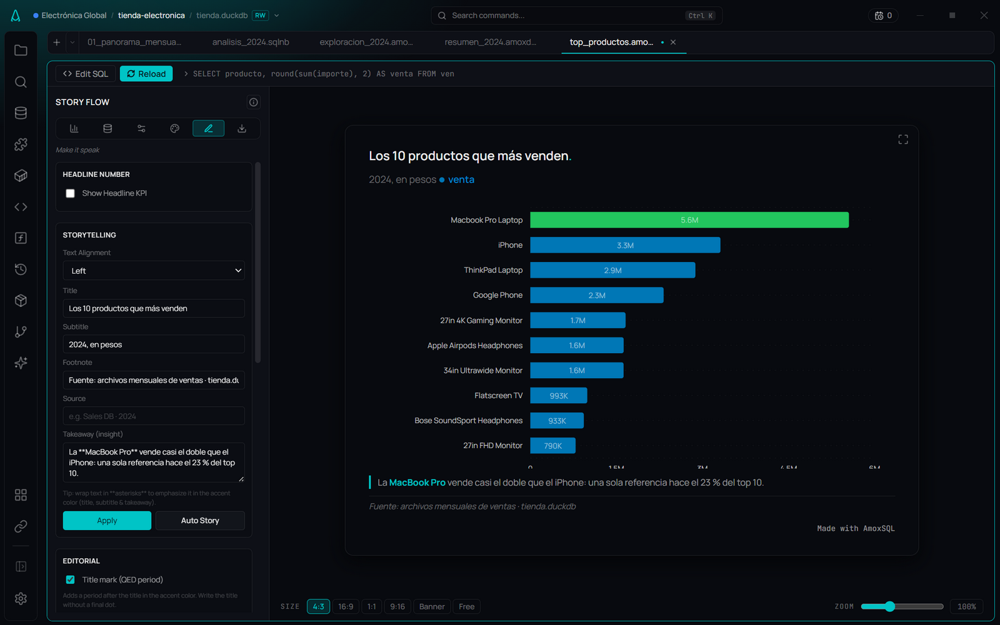

# Narrativa y overlays

**🌐 [English](../../en/visualization/storytelling-and-overlays.md) · Español**

> La etapa Story de Story Flow: lo que convierte un gráfico en una conclusión — titulares, KPIs, anotaciones, líneas de meta y referencia, foco y tendencia — más un generador de narrativa con IA.

## Qué es

La etapa **Story** ("Make it speak") es la capa narrativa de [Story Flow](story-flow.md). Un gráfico bien mapeado ya muestra los datos; esta etapa hace que el lector *entienda el punto en segundos*. Reúne el texto (título, subtítulo, takeaway, pie), un número destacado, marcas ancladas a los datos (anotaciones, líneas de meta/referencia, área de referencia), una regla de foco y una línea de tendencia — y un botón que genera la narrativa con IA.

Algunos overlays dependen del tipo de gráfico, porque solo se dibujan donde tienen sentido (ver la tabla de soporte).

## Cuándo usarlo

- Cuando el gráfico va a un informe, deck o captura y necesita **decir**, no solo mostrar.
- Para llamar la atención sobre un punto concreto (un pico, una meta, la categoría líder).
- Cuando quieras un arranque rápido de narrativa: **Auto Story** propone título, subtítulo, pie e insight a partir de una muestra de los datos, y luego lo editas.

## Cómo usarlo

### Textos y énfasis
1. En **Storytelling**, escribe **Title**, **Subtitle**, **Footnote** y **Takeaway (insight)**.
2. Pulsa **Apply** para volcarlos al gráfico.
3. Rodea texto con `**asteriscos**` en título, subtítulo y takeaway para resaltarlo en el color de acento (texto enriquecido).
4. **Text Alignment** alinea todo el bloque de texto (izquierda/centro/derecha).

### Auto Story (IA)
1. Con ejes ya mapeados, pulsa **Auto Story**.
2. La IA recibe una muestra de los datos (hasta 500 filas) y devuelve título, subtítulo, pie e insights.
3. El texto se rellena en los campos; edítalo y pulsa **Apply**.

### Headline KPI
1. Activa **Show Headline KPI**.
2. Elige la métrica: **Total (suma)**, **Average**, **Last Value** o **First Value**.
3. En **Compare With** añade un delta contra el **primer** valor o el **anterior**.
4. Ajusta el tamaño (Auto o Custom en px).

### Anotaciones
1. En **Annotations**, añade **+ Text** (marca un punto) o **+ Box** (marca una región).
2. Elige el valor X (y X final, en Box), un valor Y opcional (auto si se deja vacío) y el color.
3. Disponibles en todos los gráficos con ejes: línea, área, barra, combo, dispersión, cascada y barras con intervalo.

### Foco (Highlight)
1. En **Focus — Highlight**, elige qué resaltar:
   - **Max**, **Min** o **Specific Category** (escribe la categoría).
   - **Values below… / Values above…** — todas las barras bajo o sobre un umbral (p. ej. las campañas con ROAS menor que 1). Combínalo con una **Reference Line** en ese mismo valor.
   - **A stretch of the line** — un tramo de la serie, de un valor de X a otro (p. ej. `2025-06-10` a `2025-06-26`), dibujado encima en el color del resaltado.
2. Elige el color del resaltado. El resto del gráfico se queda en su color para que el protagonista destaque.

### Meta, referencia y área
1. **Goal Line** — activa y define valor Y, etiqueta, color y estilo (sólida/discontinua/punteada).
2. **Reference Line** — línea de referencia con etiqueta y color. El valor puede ser un número o **`mean`** / **`median`**: la línea se calcula sobre los valores que dibuja la figura.
3. **Reference Area** — banda rectangular por rango X e Y, con color y opacidad.

### Tendencia y media móvil
1. En **Trend & Average**, elige **Linear Trend** o **Moving Average**. En una dispersión las opciones son **Regression line** (la recta de mínimos cuadrados de Y sobre X) y **Smooth curve** (una curva suavizada).
2. Para la media móvil, define el **tamaño de ventana**.
3. Solo en serie única (línea, barra, dispersión); con varias series o Split By no aplica.

## Referencia de opciones

| Sección | Opción | Valores / notas |
|---|---|---|
| Headline Number | Show Headline KPI | On/Off |
| | Metric | Total · Average · Last Value · First Value |
| | Compare With | None · First Value · Previous Value (muestra el delta) |
| | Font Size | Auto · Custom (12–72 px) |
| Storytelling | Title · Subtitle · Footnote · Takeaway | Texto; `**...**` resalta en acento (título/subtítulo/takeaway) |
| | Text Alignment | Left · Center · Right |
| | Auto Story | Genera textos con IA a partir de una muestra |
| Annotations | + Text / + Box | Punto (X, Y) o región (X→X2, Y→Y2) + color |
| Focus — Highlight | Type | None · Max · Min · Specific Category · Values below/above (umbral) · A stretch of the line (de X a X) (+ color) |
| Goal Line | Enabled, Y Value, Label, Color, Style | Style: Solid · Dashed · Dotted |
| Reference Line | Value, Label, Color | Un número, o `mean` / `median` |
| Reference Area | X Start/End, Y Start/End, Color, Opacity | Banda rectangular |
| Trend & Average | Overlay | None · Linear Trend · Moving Average (+ Window Size) · en dispersión: Regression line · Smooth curve (+ color) |

### Soporte por tipo de gráfico
| Overlay | Dónde se dibuja |
|---|---|
| Anotaciones | Línea, barra, combo, dispersión, cascada, barras con intervalo |
| Foco (Highlight) | Línea, barra, caja (por categoría), barras con intervalo |
| Meta / Referencia / Área | Línea, barra, combo, dispersión, cascada, barras con intervalo |
| Tendencia / Media móvil / Regresión | Línea, barra, dispersión (serie única) |
| Media y mediana del histograma | Histograma (en **Data**) |

El panel solo muestra los overlays que el tipo activo puede dibujar, así nunca ofreces un control que no haría nada.

## Tips y gemas

- **Un titular afirma, no describe:** "El Sur lidera con el 16% de ventas", no "Ventas por región".
- **Anota el momento que importa:** marca el pico o el evento, no cada punto.
- **Contexto en el número:** empareja siempre un valor con su cambio o comparación (Headline + delta).
- **Auto Story rellena, tú decides:** trata el texto de la IA como borrador; el **Apply** manual es lo que lo fija.
- **La tendencia se descarta si no aplica:** con varias series la línea de tendencia sería una suma sin sentido, así que ni se ofrece.

## Relacionado

- [Story Flow](story-flow.md) · [Tipos de gráfico](chart-types.md)
- [Formato y estilo](format-and-style.md) · [Asistente de IA](../ai/editor-assistant.md)
